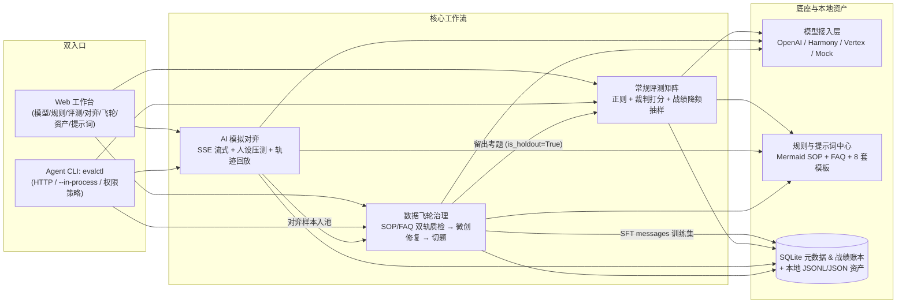
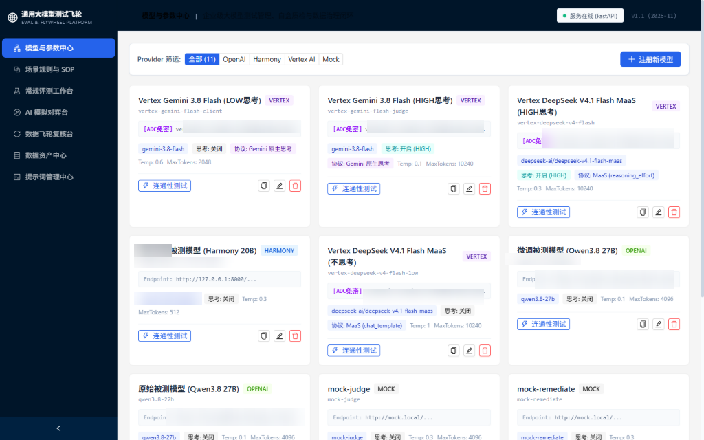
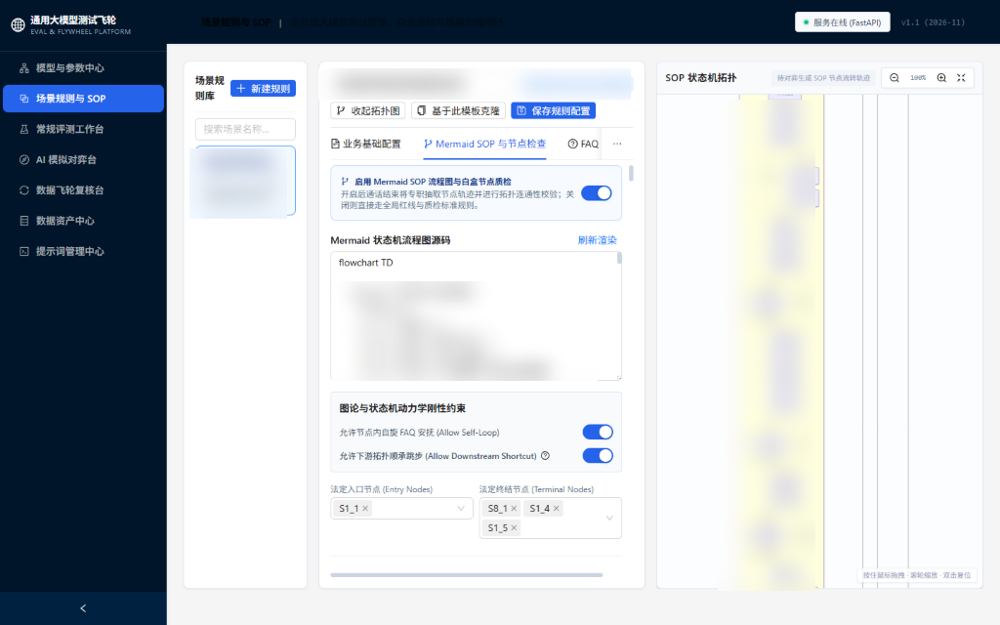
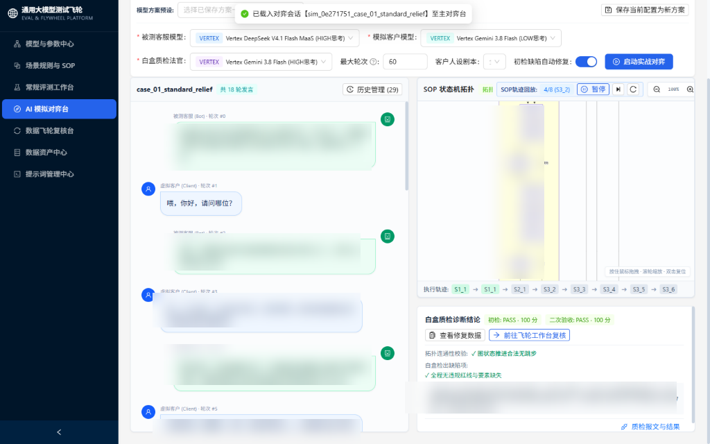

# 大模型多轮对话评测与数据飞轮平台（Eval & Data Flywheel Platform）

这是一个主要面向**客服、外呼等多轮对话场景微调与回归测试**的开源工作台，同时提供 Web 界面与面向本地 Coding Agent 的命令行工具 `evalctl`。

它的设计出发点比较聚焦：在做客服或任务型多轮对话模型微调（SFT / LoRA）时，常见问题往往集中在三处——微调前后对比评测缺维度或被接口超时污染、长对话人工抽检难以核对 SOP 节点与 FAQ 口径、以及大模型直接清洗对话数据时容易“顺手润色客户原话”或改出上下文错位。

因此，平台把**模型接入、常规对比评测、多轮模拟对弈、SOP/FAQ 规则质检、局部微创修复、切题与留出隔离导出**串成了一套可复核的工作流。

---

## 定位与适用边界

在决定是否使用本项目前，建议先确认它适合做什么、不适合做什么：

### 最适合的场景
- **客服 / 外呼 / 流程引导类多轮对话微调迭代**：比较不同微调版本（或同模型开/关思考配置）在合规话术、业务推进和基础问答上的表现变化。
- **有明确业务规范的对话质量体检**：基于你配置的 Mermaid SOP 状态机、红线约束和 FAQ 知识库，对存量多轮对话语料或模拟对话做批量规则打分与问题定位。
- **小样本微创洗数与验证集沉淀**：针对质检挑出毛病的对话，只替换违规的坐席回复或成对删掉冗余问答，保留真实客户口语原话；同时把修正过的关键轮次切为单轮上文考题并做 Holdout 隔离，用于后续回归评测。
- **受控冷启动对话采样**：在已有流程与人设的前提下，可挂载能力更强的模型模拟对话补充样本，再经过质检、修复和人工复核后导出 `messages` 格式训练集。

### 不适合 / 并非设计目标
- **不是全功能通用质检平台**：不针对代码生成（如沙箱单测）、数学/科学硬推理、多模态理解、复杂工具调用链（Tool-Use Agent）或开放式长文写作做专项质检。
- **不是无中生有的通用造数工厂**：数据能力高度围绕 `user / assistant` 严格交替的多轮对话展开，质检和修复的效果高度依赖使用者事先梳理好的 Mermaid 流程图、FAQ 与人设剧本；它擅长“按规则挑错并做局部话术修补”，而非凭空批量合成任意领域的百科或预训练语料。
- **不能替代人工终审**：底层仍依赖大模型裁判与修复器，遇到规则边界模糊或复杂客诉时仍可能误判或漏修，高价值或边缘样本需要在飞轮复核台抽检把关。

---

## 核心能力与工程取舍

### 1. 围绕对话微调迭代的四段式工作流
- **模型对比评测（`/benchmarks`）**：同一份带标尺的数据集可同时跑多个模型或不同参数配置（如开思考 vs 关思考），按客观正则（含 `!` 前缀反向禁含规则）、LLM 评分细则及延迟/TTFT/TPS 对比结果，并支持按胜负分歧筛选 Side-by-Side 明细。
- **多轮模拟对弈（`/simulation`）**：AI 按配置的人设（如急躁、抗辩、简短敷衍、常规咨询等）与待测客服模型进行 SSE 流式多轮对话，支持人工随时自由接管测试；也支持直接对已有纯对话数据集做批量规则体检（`inspect-dataset`，与带参考答案的常规考题评测严格分开，避免纯对话跑出虚高通过率）。
- **白盒规则质检与微创修复（`/flywheel`）**：对有缺陷的对话生成修复建议，经二次质检验收后进入人工复核；确认通过的样本可导出标准 `messages` 格式 SFT 数据集。
- **渐进切题与防泄漏导出**：将修补过的关键坐席轮次切为带累计正确上文的评测样本，自动打上 `is_holdout=True` 留出标记；之后导出 SFT 训练集时默认过滤掉已切题样本，避免考题回流训练集。

### 2. 质检机制：为什么拆成「状态机校验 + FAQ 检索 + 裁判打分」
在几十轮的长客服对话里，如果只用一条 Prompt 让大模型一边核对业务流程图、一边查上百条 FAQ 口径、一边按红线扣分，经常会出现漏节点或“评语指出漏环节但分数依然给很高”的情况；反过来，如果代码查到流程图断路就一刀切判死，又容易误杀“客户赶时间主动挂机”或“客户一句话提前说完多个信息”的正常对话。

平台采用双开关控制的拆解做法：
- **SOP 流程轨道（`topology_sop`）**：先由轻量步骤抽取每轮推进的节点与客户顺带提供的槽位，再由有向图校验器计算节点自旋（如中途答疑）、合法推进、已填槽位顺承以及客户早退挂机豁免，把“是否断路、卡在哪个节点”作为客观事实喂给裁判模型打分，代码层不直接越权改分。
- **FAQ 问答轨道（`faq_inspection`）**：抽取客户提问并做上文改写，通过 BM25 + 向量混合检索（RRF 融合；无本地向量模型或离线环境时自动回退特征哈希）召回相关知识条目，交由 FAQ 裁判核对坐席口径。
- **单轨合成修复**：到了修复阶段合并处理，让模型在同一轮坐席回复里完成“解答疑问 + 过渡承接 + 拉回当前主线节点”。

> 提示：若你的业务没有固定流程或 FAQ（只是开放闲聊），可以关闭对应开关，仅使用通用红线规则做基础打分。

### 3. 对话修复：保留客户原话，局部替换与成对删轮
直接让大模型整篇改写对话常见两个坑：一是模型容易把真实客户口语里的粗糙、急躁或带错别字的表达“润色”成客气书面语，拿去微调会导致模型不适应真实线上输入；二是只改某一句客服追问，却没注意到下一轮客户原话还在回答旧问题，导致上下文“问东答西”。

平台的修复器采用单次推理产出声明式操作清单：
- **`replace`（话术替换）**：仅修改不合规的 `assistant` 回复；后处理代码会逐轮核对 `user` 文本，若大模型擅自改动了客户原话，代码会直接还原为原始文本。
- **`prune`（成对剪枝）**：当修改单句会破坏下文衔接，或开场/中间出现无效兜圈时，按原始轮次成对剔除多余的“一问一答”（仅结尾未收口的孤立 `user` 轮支持单删），尽量保持上下文自然连贯而不编造客户发言。
- **二次验收与按新规则重检**：修复后需要再过一次验收（未过可触发定点补考，仍不达标进入 `discarded` 隔离库）。如果后期调松了规则，可以在复核台触发**仅重检不重修（Re-Judge）**，直接按新标准重算历史样本得分。

### 4. 长对话切题：按原轮次号滚雪球累积上文
模拟或修出来的完整会话以客服收尾，不能直接原样放进单轮/上下文评测集。如果拿没修过的脏对话当后半段考题的上文，前序错误话术会误导被测模型；直接按数组下标截取，又会因为 `prune` 删过轮次而错位。

切题引擎（`ProgressiveContextSlicer`）的做法是：
- 按不可变的原始轮次号从前往后扫描，自动跳过已被 `prune` 的轮次，并把前序已经 `replace` 修好的回复累积带入后续考题的上文（若外呼首轮即触发切题，会自动补一条接通引导语确保上下文合法）；
- 仅针对实际被 `replace` 修改过且匹配到扣分项的坐席轮次切出考题，以修正后的回复作为参考答案；
- 在切题预览面板微调参考答案时，支持同步回写进整篇 SFT 对话，尽量保证训练数据与评测标答口径一致。

### 5. 常规评测：异常隔离与基于战绩的降频抽样
- **网络异常隔离**：适配器底层默认最多重试 5 次；若仍遭遇超时、429 限流或 502 等错误，样本标记为 `API_ERROR` 并跳过规则和裁判打分，在汇总指标和分歧筛选中单独统计，不拉低模型业务通过率。
- **思考链剥离与 Token 覆盖**：兼容 OpenAI / vLLM / SGLang / DeepSeek、Harmony 双通道（`<|channel|>final`）以及 Google Vertex AI（ADC 免密及思考协议自适应探测），在接入层统一分离 `thinking` 与正文 `content`；评测时支持任务级统一覆盖 `max_tokens` 与忽略样本自带 `max_new_tokens` 限制。
- **战绩账本与阶梯降频抽样**：针对规模不断增大的留出验证集，支持启用基于 SQLite 账本（`benchmark_run_ledgers`）的降频抽样（原始题库 `.jsonl` 保持只读）。经确认属于未训练留出题的样本，在连续多个版本稳定通过后会逐步拉长复测间隔，并按紧迫度配额平滑抽检；一旦新版退化做错则清零连胜、下轮拉回必测。报告同时展示「本轮实测通过率」和「结合熟题折算的全集等效通过率」，避免隐瞒抽样口径。

### 6. 工程细节与双入口
- **保留 Prefix Cache**：模拟对弈中每轮变化的客户情绪、耐受度等动态提示附在最新一轮 `user` 消息末尾，使静态 `system` 前缀保持不变，减少长对话调用时的缓存失效开销。
- **全配置化与在线调试**：场景流程图、红线、FAQ、客户人设以及引擎内置的 8 套提示词模板均可在界面编辑，规则中心支持拼装真实上下文并在线调用已注册模型做单步实测（支持导出报文）。
- **Agent CLI (`evalctl`)**：除 Web 工作台外，提供覆盖 8 大命令组、60 条子命令的 `evalctl` CLI，支持紧凑表格输出、大载荷落盘（防撑爆上下文）、`--in-process` 免启服务端直调，以及 5 套可裁剪命令的权限 Profile（如 `readonly`、`eval-loop`、`flywheel-loop` 等）。

---

## 平台结构概览



---

## 界面实景展示

> 为保护实际业务信息，以下截图中的私有业务名称、规则标识、GCP Project ID、模型端点 URL 及具体对话与评语文本均已做打码脱敏处理。

### 1. 模型与参数中心 (`/models`)
统一纳管 OpenAI 兼容端点、Harmony 模型、Google Vertex AI（ADC 免密）与离线 Mock 模型，支持克隆多套思考深度配置同台对比，以及一键连通性测试。



### 2. 场景规则与 SOP 中心 (`/rules`)
配置 Mermaid 状态机流程图、图论动力学约束（节点自旋 / 下游顺承 / 入口与出口）、FAQ 知识库以及可在线组装调试的 Prompt 模板。



### 3. 常规评测报告：雷达图与指标概览 (`/benchmarks/:taskId`)
对比多模型（或同模型不同超参）在客观通过率、LLM 裁判均分、延迟、TTFT、吞吐率与思考 Token 深度上的表现，并支持按分歧状态筛选。


### 4. 常规评测报告：微观 Side-by-Side 分歧对比
聚焦“一方对、一方错”的差异样本，并排展示各模型输出、工程指标、正反向正则校验明细与裁判扣分点评。


### 5. AI 模拟对弈台 (`/simulation`)
支持 SSE 流式双 Agent 多轮对弈与人工自由接管；右侧联动 Mermaid SOP 节点轨迹回放与白盒质检结论，可一键流转进入飞轮复核。



### 6. 数据飞轮复核台：双诊断对比与轮次级修复 (`/flywheel`)
同屏展示初检缺陷、二次验收结论与底层报文调试弹窗；下方左右双栏逐轮对比修复改动（「已优化」高亮 + 客户原话还原），支持 Monaco 源码 Diff、切题预览与防泄漏导出。


---

## 目录结构

```text
eval-platform/
├── backend/                # FastAPI 服务、模型适配器、评测/对弈/质检/修复/切题/抽样引擎与 pytest 测试
├── cli/                    # evalctl 命令行工具、60 条子命令与权限策略 Profile 配置
├── frontend/               # React + TypeScript + Vite + Ant Design + Mermaid + ECharts + Monaco 工作台
├── docs/                   # 设计方案文档、系统地图 (docs/map/) 与脱敏界面截图 (docs/images/)
├── data/                   # 本地数据资产目录（规则、数据集、运行产物、SQLite 数据库，默认已 Git 忽略）
├── AGENTS.md               # 项目导览地图与开发/系统地图同步规范
├── lessons.md              # 实战踩坑与设计约束记录
└── pyproject.toml          # 包构建与 evalctl 命令入口配置
```

---

## 快速开始

### 1. 环境准备

- **Python**: `>= 3.10`
- **Node.js**: `>= 18`（前端构建与开发服务器）

安装后端与 CLI 依赖（并注册 `evalctl` 命令）：

```bash
pip install -r backend/requirements.txt
pip install -e .
```

### 2. 环境变量配置（按需）

| 变量名 | 说明 | 默认值 |
| :--- | :--- | :--- |
| `SERVER_HOST` | 后端监听地址 | `127.0.0.1` |
| `SERVER_PORT` | 后端监听端口 | `9021` |
| `DATABASE_URL` | SQLite / PostgreSQL 连接串 | `sqlite:///.../data/eval_platform.db` |
| `VERTEX_PROJECT` | Google Cloud Vertex AI Project ID（使用 Vertex 时填写） | `your-gcp-project-id` |
| `VERTEX_LOCATION` | Vertex AI 区域 | `global` |

> 使用 Google Vertex AI 模型时，请先在本机完成 ADC 鉴权（`gcloud auth application-default login`），并在模型配置或环境变量中指定 Project ID 与 Location。

### 3. 启动后端与前端工作台

```bash
# 1. 启动后端 FastAPI 服务（默认监听 127.0.0.1:9021）
uvicorn backend.app.main:app --host 127.0.0.1 --port 9021 --reload

# 2. 启动前端 Vite 工作台（默认监听 5173 并反向代理 /api 至 9021）
cd frontend
npm install
npm run dev
```

启动后访问 `http://localhost:5173` 打开 Web 工作台；后端交互式 API 文档位于 `http://127.0.0.1:9021/docs`。

### 4. 使用 Agent CLI (`evalctl`)

```bash
# 查看健康状态与当前策略放行的命令清单
evalctl system health
evalctl --format compact system capabilities

# 未启动 :9021 服务时，可加 --in-process 进程内直调后端
evalctl --in-process --format table model list --brief

# 查看权限策略 Profile（支持 full / safe / readonly / eval-loop / flywheel-loop）
evalctl system policy

# 示例：跑一次多模型对比评测，并查看有分歧的样本摘要（可替换为自己的数据集路径）
evalctl --timeout 0 benchmark run --dataset-path data/datasets/demo_benchmark.jsonl \
  --model-id mock-a --model-id mock-b --wait
evalctl benchmark side-by-side <task_id> --filter divergence --summary-only
```

> 完整的 CLI 参数、防撑爆上下文选项（`--out`、`--brief`）与退出码约定见 [cli/SKILL.md](cli/SKILL.md)。

### 5. 运行测试与系统地图校验

```bash
# 运行后端与 CLI 全量回归测试
python -m pytest -v

# 校验系统地图与代码 AST 事实对齐
python docs/map/build.py --strict-facts

# 前端类型检查与生产构建
cd frontend && npm run build
```

---

## 延伸文档与数据安全

- **设计文档**：
  - [平台总体架构设计方案](docs/DESIGN_PLAN.md)
  - [前端工作台信息架构与交互规范](docs/FRONTEND_DESIGN.md)
  - [双轨并行质检（Mermaid ∥ FAQ）与动态免训闭环设计](docs/FLYWHEEL_FAQ_EVAL_LOOP_DESIGN.md)
  - [模拟对练质检切题与数据中心分类管理方案](docs/FLYWHEEL_BENCHMARK_GENERATION_DESIGN.md)
  - [常规评测动态阶梯降频抽取与战绩账本方案](docs/BENCHMARK_SAMPLING_FILTER_DESIGN.md)
- **隐私与数据安全**：
  - 本地 `data/rules/*.json`、`data/datasets/*.jsonl`、`data/runs/*.json`、`data/runs/*.md` 以及 `*.db` / `.env` 均已在 [`.gitignore`](.gitignore) 中默认忽略，避免将私有业务规则、SOP 流程图、测试数据或密钥提交至代码仓库。
