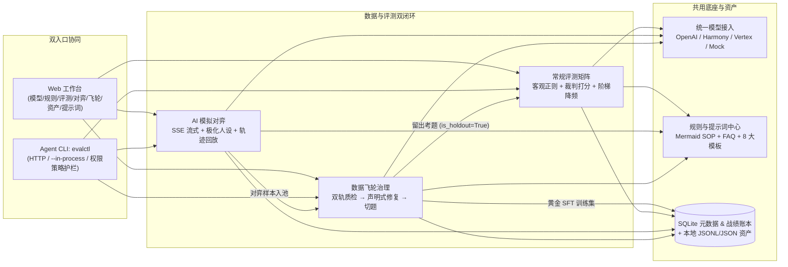
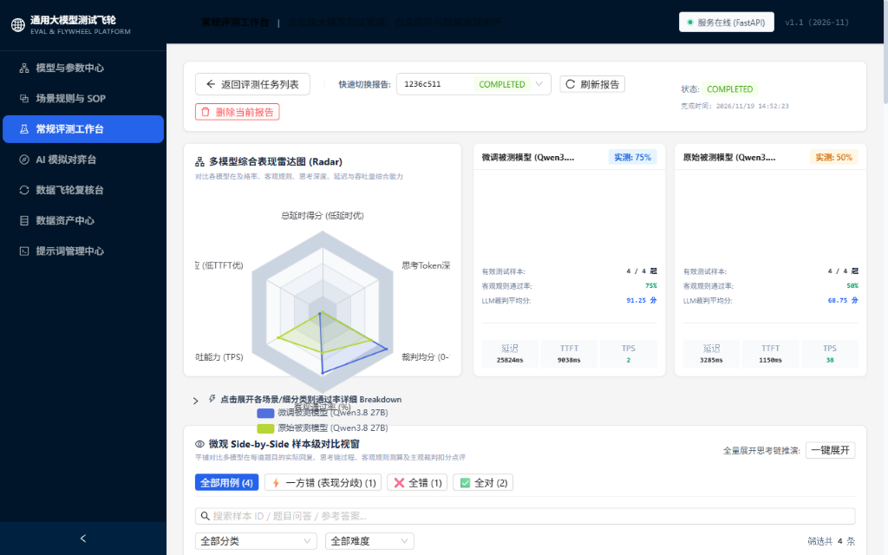
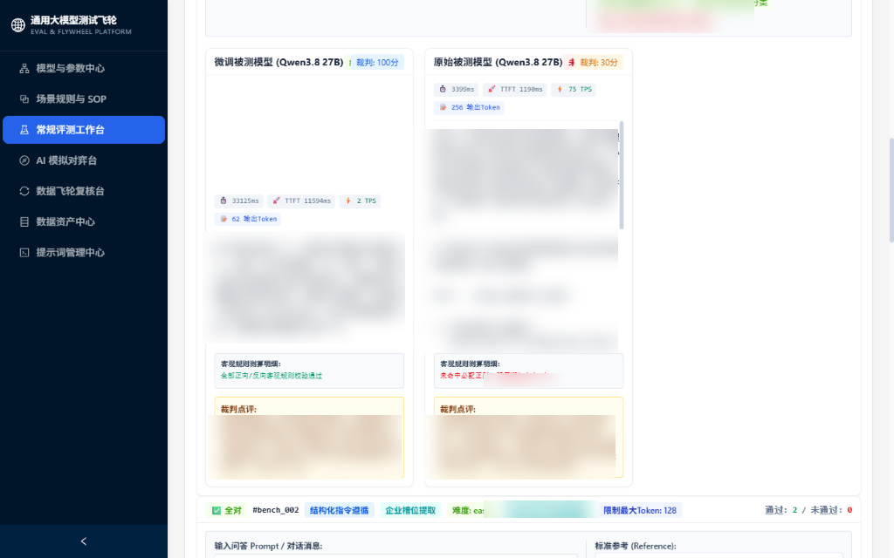
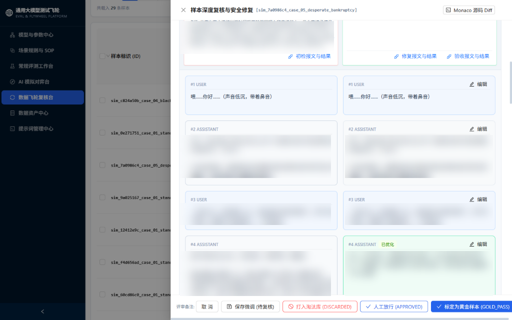

# 通用大模型测试管理与数据飞轮平台（Eval & Data Flywheel Platform）

做对话机器人微调和评测时，最头疼的往往不是调不通 API，而是这几件事：
- **评测指标失真**：网络超时被算成模型答错；微调后在某类问题上变强了，通用能力或旧题却悄悄退化；每次全量跑一次大评测集又慢又烧钱。
- **人工抽检盲人摸象**：纯靠大模型给几十轮长对话打分，经常“嘴上礼貌就给 85 分”，漏掉关键业务跳步；真发现问题想修，大模型一顺手把客户原话也改成了书面语，拿去微调直接导致线上分布漂移。
- **造数据与评测两张皮**：对弈修出来的完整对话没法直接当考题，强行切题又容易把前面的错话、删掉的轮次序号全搞乱，甚至不小心把考题混进训练集，考出虚高的“背题 100 分”。

这个平台就是为了解决这些工程死结而设计的——**把“模型接入 → 常规对比评测 → AI 模拟对弈 → 白盒质检 → 靶向修数据 → 切题与防泄漏导出”串成一条可验证、可回溯的闭环**，同时为人工和本机 Coding Agent 提供两套入口（Web 工作台 + `evalctl` 命令行）。

---

## 设计思想与核心亮点

### 1. 一套引擎多重用法：支撑「模型接入 → 采样/对弈 → 质检/评测 → 数据沉淀 → 微调」循环递进
平台里的核心模块不是孤立的一次性工具，而是按“模型迭代生命周期”自由组合复用：
- **质检引擎的多用途（评价 · 产训 · 留测三合一）**：
  - **多轮对话质量体检（只检不修）**：针对已有纯对话语料或 SFT 训练集，直接在「数据集中心」或通过 `evalctl flywheel inspect-dataset` 按 SOP 状态机 + 红线 + FAQ 批量规则质检打分，产出通过率、均分、拓扑连通率与高频扣分项看板（并与“仅测有标尺考题”的常规评测严格隔离，杜绝纯对话跑出假阳性 100% 通过）。
  - **生成黄金微调数据集**：质检检出缺陷后送入声明式微创修复与二次验收，达标样本导出为标准 `messages` 格式 SFT 训练集，用于新一轮 LoRA / 全参微调。
  - **沉淀留出验证集**：对修复纠正过的关键轮次做渐进切题并自动加挂 `is_holdout=True` 防泄漏锁，稳定沉淀为可持续复测的基准验证集 / 评测集。
- **模拟对弈的多用途（既测模型，也用老师模型采样造数）**：
  - **测模型实战性能**：把微调后的小模型或待测模型挂为对话目标，用极化客户人设矩阵压测多轮业务推进、抗压安抚与红线遵从能力。
  - **老师模型 / 推理模式采样数据集**：在冷启动或长尾场景缺数据时，把**高性能大模型（或开启高思考/推理模式的模型）**挂为对话目标直接对弈采样，再经白盒质检与微调清洗导出高质量训练集，低成本反哺小模型微调。
- **配合微调模型，驱动迭代循环递进**：
  - 每次微调产出新版模型后，重新接入「模型中心」并复用同一套模拟剧本、批量规则质检与动态降频验证集进行对比验收——验证目标场景是否提升、通用与熟题是否退化；把本轮新暴露的短板继续采样、修复、沉淀为下一批 SFT 数据与回归考题，形成 **「模型接入 → 模拟对话 / 老师模型采样 → 质检与评测 → 训练集 / 验证集沉淀 → 微调新版本」** 的螺旋递进闭环。

### 2. 别让大模型闭眼盲判：代码只递“客观事实”，裁决权留给法官
在长对话质检里，纯 Prompt 让大模型一边理清几十轮的流程轨迹、一边核对上百条 FAQ 知识、一边还要按红线打分，注意力很快就会被稀释——经常出现“提取出来的轨迹明明缺了环节，法官评语却给高分放行”的自相矛盾。

反过来，如果代码查到流程图有断路就硬编码一刀切死判 50 分，又会误杀“客户赶时间主动挂机”、“客户一句话提前交代完三个信息”这种本来合理的正常对话。

**我们的做法是“分工 + 事实注入 + 权责分离”：**
- **流程和问答分轨看**：把「Mermaid 流程图合规」和「FAQ 知识库准确度」拆成两条独立开关控制的并行轨道，各自用轻量化步骤提取轨迹或改写检索词（BM25 + 向量混合召回官方口径），互不干扰；到了修复阶段再合并成单轨，在同一轮话术里一次性完成“解答问题 + 自然过渡 + 拉回主线”。
- **图论只做“呈堂证供”，不越权改分**：先用确定性图论校验器把合法自旋（中途答疑）、顺承跳步、客户挂机早退豁免算清楚，再把“是否断路、停在哪个节点”作为客观事实塞进裁判上下文，最后统一由法官结合语境打分。

### 3. 数据修复的底线：客户原话一个字不能改，聊歪了就“成对删”
传统用大模型洗对话数据，最大隐患是大模型喜欢“润色”，把真实客户口语里含糊、急躁、带错别字的表达也改成客客气气的标准书面语。拿这种假对话去 SFT 微调，模型上线碰到真实客户就会水土不服。

更棘手的是“因果断裂”：比如真实客户第一句就把地址和型号全说了，原客服没听懂又傻傻追问了一遍。如果你只把客服这句追问改掉，下一轮客户原话还在回答旧问题，上下文直接“问东答西”。

**我们的做法是“单次推理・声明式双工具”：**
- **`replace`（话术替换）**：只许修改违规的坐席回复，后处理代码强校验客户（`user`）发言 **100% 物理冻结还原**，大模型敢改一个字也会被硬掰回来。
- **`prune`（成对剪枝）**：一旦发现改写单轮会引发下文答非所问，或者开场/中间出现无效兜圈，直接成对剔除多余的“一问一答”，让前文无缝咬合后续真实对话，宁可少一轮，绝不替客户编造半句假话。
- **漏斗验收 + 低成本重检**：修完不是直接入库，必须过一次“二次验收 / 定点补考”，实在修不好的进淘汰隔离库（`discarded`）；如果后来发现是规则写严了，支持对历史样本触发**只检不修（Re-Judge）**，按新标准直接救回被误杀的样本。

### 4. 长对话怎么转成可复测的考题？——累积上文切题 & 训测源头隔离
模拟对弈修出来的是一整通以客服收尾的完整会话，没法直接丢进常规评测集里测单轮响应。如果对后半段出现的错题直接拿“原始脏对话”当上文，前序错误话术会误导被测模型；如果剪完枝按数组下标截取，轮次位置又会全乱套。

**我们的做法是“按原始序号滚雪球切题 + 物理防泄漏”：**
- **不可变原始序号切题**：切题时不看剪枝后的物理下标，而是按原对话不可变的轮次号从前往后扫——前面已经被 `prune` 剪掉的自动过滤，前面已经被 `replace` 修好的黄金话术自动累积继承进后续考题的上文里，外呼首轮缺失上文还会自动补位引导语。
- **双源真标答 + 双向同步**：只针对真正被修复改写过的轮次切题，拿修复后的回复当标准答案；人工在切题面板微调了参考答案，会同步回写进整篇 SFT 对话，保证训练和评测永远对齐同一份真相。
- **源头物理防泄漏**：一旦哪条对话被切题进了评测集，系统就自动给它打上“留出（Holdout）”锁，之后导出 SFT 黄金训练集时默认强制把它排除在外——从制度上杜绝“拿考题练模型，再考出高分”的自嗨。

### 5. 评测降本不是靠“猜重复”，而是用“动态错题本”让战绩说话
题库越攒越多，每次微调完跑一遍全量测试很慢；但靠算文本相似度或大模型两两比对来去重，极易把“只差一个否定词、业务分支完全相反”的考题误当成重复题删掉。

**我们的做法是“放弃静态去重，按真实战绩动态降频”：**
- **只追加账本 + 题库 100% 只读**：所有评测样本文件保持只读不污染，每次评测的战绩按「数据集 + 模型线」记在 SQLite 流水账本里，同版本重跑直接复用题单保证可比性，题目内容一旦改动指纹自动失效，跑错了还能按任务一键撤销（`revoke-ledger`）。
- **固定阶梯降频 + 紧迫度配额平滑**：只有确认未进过训练集的留出题才允许降频。一道题在连续多个不同版本稳稳做对后，系统会按阶梯拉长它的复测间隔，并按“轮空紧迫度”把每轮要巡检的熟题均匀错峰（不搞随机抛硬币那种抽样数量抖动）；一旦新版本做错退化，连续通过记录立刻清零，下轮拉回必测。
- **双口径透明报账**：报告里把「本轮实测通过率」和「结合熟题保留率折算的全集等效通过率」分开列清楚，既省算力又不虚报数字。

### 6. 为“模型对比”和“省钱省心”抠到细节的工程习惯
- **不拿网络故障罚模型**：调用超时、限流 429 或 502 直接隔离标记为 `API_ERROR`，跳过规则和裁判打分，绝不拉低业务通过率，对比页还能一键筛出“一方错（胜负分歧）”的样本集中排查。
- **思考过程独立剥离对比**：不管底层是 OpenAI/DeepSeek、Harmony 双通道还是 Vertex AI（原生或 MaaS 自适应探测），在接入层就把思考链和正文剥干净，支持同一个模型克隆出“开思考 vs 关思考”两个实例直接同台跑分，连思考耗时占比、TTFT、TPS 一起对比。
- **保住 Prefix Cache**：模拟对弈里每轮都会变化的客户情绪和耐受度，绝不塞进 `system` 里，而是拼在最新一轮 `user` 末尾——让静态 `system` 前缀 100% 命中云厂商缓存，长对话跑下来既快又省钱。

### 7. 把规则与 Prompt 全抽成配置，顺便给 Coding Agent 也修好专用跑道
- 平台里**没有任何写死的具体业务流程或话术**：流程图、红线、FAQ、人设剧本、甚至连引擎自己用的 8 套内部 Prompt 模板都可以在工作台直接编辑、拼装真实上下文报文并在线秒级实测，换业务只需换一份配置。
- 除了让人点鼠标的 Web 工作台，还专门做了面向本机 Coding Agent 的命令行工具 **`evalctl`**（8 大命令组、61 条子命令）：支持紧凑表格、大载荷强制落盘防撑爆上下文、`--in-process` 免启服务直调，还内置了 5 套权限 Profile（比如给自动化评测 Agent 只放行跑测和看结果，锁死删库和改配置）。

---

## 平台全景图



---

## 界面实景展示

> 为保护实际业务隐私，以下截图中的私有业务名称、规则标识、GCP Project ID、模型端点 URL 及具体对话与评语文本均已做打码脱敏处理。

### 1. 模型与参数中心 (`/models`)
统一纳管 OpenAI / vLLM / Harmony / Vertex AI（ADC 免密）与 Mock 模型，支持克隆多套思考深度配置同台对比，并支持一键连通性测试。


### 2. 场景规则与 SOP 中心 (`/rules`)
用可视化界面配置 Mermaid 状态机流程图、图论动力学约束（节点自旋 / 下游顺承 / 法定入口与出口）、FAQ 知识库与可在线组装调试的 Prompt 模板。


### 3. 常规评测报告：多模型雷达图与核心 KPI (`/benchmarks/:taskId`)
直观对比多模型（或同模型不同参数）在客观通过率、LLM 裁判均分、延迟、TTFT、吞吐率与思考 Token 深度上的差异，并支持按分歧状态快捷筛选。



### 4. 常规评测报告：微观 Side-by-Side 分歧对比
聚焦“一方对、一方错”的差异样本，并排展示各模型的纯净输出、工程指标胶囊、正反向正则校验明细与裁判扣分点评。



### 5. AI 模拟对弈台 (`/simulation`)
支持 SSE 流式双 Agent 多轮对战与人工自由接管；右侧联动 Mermaid SOP 节点轨迹动画回放与白盒质检结论，一键流转进飞轮复核。


### 6. 数据飞轮复核台：双诊断对比与轮次级安全修复 (`/flywheel`)
同屏展示初检缺陷诊断、二次验收结论及底层报文调试弹窗；下方左右双栏逐轮对比修复改动（「已优化」高亮 + 客户原话冻结），支持切换 Monaco 源码 Diff、切题预览与防泄漏导出。



---

## 目录结构

```text
eval-platform/
├── backend/                # FastAPI 服务、多厂商适配器、评测/对弈/质检/修复/切题/抽样引擎与 pytest 测试
├── cli/                    # evalctl 命令行工具、61 条子命令与权限策略 Profile 配置
├── frontend/               # React + TypeScript + Vite + Ant Design + Mermaid + ECharts + Monaco 工作台
├── docs/                   # 架构设计方案、系统地图 (docs/map/) 与脱敏界面截图 (docs/images/)
├── data/                   # 本地数据资产目录（规则、数据集、运行产物、SQLite 数据库，已默认 Git 忽略）
├── AGENTS.md               # 项目导览地图与开发/系统地图同步规范
├── lessons.md              # 实战踩坑与设计原则记录
└── pyproject.toml          # 包构建与 evalctl 命令入口配置
```

---

## 快速开始

### 1. 环境准备

- **Python**: `>= 3.10`
- **Node.js**: `>= 18`（前端构建与开发服务器）

安装后端与 CLI 依赖（注册全局 `evalctl` 命令）：

```bash
pip install -r backend/requirements.txt
pip install -e .
```

### 2. 环境变量配置（按需）

| 变量名 | 说明 | 默认值 |
| :--- | :--- | :--- |
| `SERVER_HOST` | 后端监听地址 | `127.0.0.1` |
| `SERVER_PORT` | 后端监听端口 | `9021` |
| `DATABASE_URL` | SQLite / PostgreSQL 连接串 | `sqlite:///.../data/eval_platform.db` |
| `VERTEX_PROJECT` | Google Cloud Vertex AI Project ID（使用 Vertex 时填写） | `your-gcp-project-id` |
| `VERTEX_LOCATION` | Vertex AI 区域 | `global` |

> 使用 Google Vertex AI 模型时，请先在本机完成 ADC 鉴权（`gcloud auth application-default login`），并在模型配置或环境变量中指定 Project ID 与 Location。

### 3. 启动后端与前端工作台

```bash
# 1. 启动后端 FastAPI 服务（默认监听 127.0.0.1:9021）
uvicorn backend.app.main:app --host 127.0.0.1 --port 9021 --reload

# 2. 启动前端 Vite 工作台（默认监听 5173 并反向代理 /api 至 9021）
cd frontend
npm install
npm run dev
```

启动后访问 `http://localhost:5173` 打开 Web 工作台；后端交互式 API 文档位于 `http://127.0.0.1:9021/docs`。

### 4. 使用 Agent CLI (`evalctl`)

```bash
# 查看健康状态与当前策略放行的命令清单
evalctl system health
evalctl --format compact system capabilities

# 未启动 :9021 服务时，可加 --in-process 进程内直调后端
evalctl --in-process --format table model list --brief

# 查看权限策略 Profile（支持 full / safe / readonly / eval-loop / flywheel-loop）
evalctl system policy

# 示例：跑一次多模型对比评测，并只看胜负有分歧的样本摘要
evalctl --timeout 0 benchmark run --dataset-path data/datasets/demo_benchmark.jsonl \
  --model-id mock-a --model-id mock-b --wait
evalctl benchmark side-by-side <task_id> --filter divergence --summary-only
```

> 完整的 CLI 闭环用法、防爆上下文参数（`--out`、`--brief`）与退出码约定见 [cli/SKILL.md](cli/SKILL.md)。

### 5. 运行测试与系统地图校验

```bash
# 运行后端与 CLI 全量回归测试
python -m pytest -v

# 校验系统地图与代码 AST 事实对齐
python docs/map/build.py --strict-facts

# 前端类型检查与生产构建
cd frontend && npm run build
```

---

## 延伸文档与数据安全

- **核心设计文档**：
  - [平台总体架构设计方案](docs/DESIGN_PLAN.md)
  - [前端工作台信息架构与交互规范](docs/FRONTEND_DESIGN.md)
  - [双轨并行质检（Mermaid ∥ FAQ）与动态免训闭环设计](docs/FLYWHEEL_FAQ_EVAL_LOOP_DESIGN.md)
  - [模拟对练质检切题与数据中心分类管理方案](docs/FLYWHEEL_BENCHMARK_GENERATION_DESIGN.md)
  - [常规评测动态阶梯降频抽取与战绩账本方案](docs/BENCHMARK_SAMPLING_FILTER_DESIGN.md)
- **隐私与数据安全**：
  - 本地 `data/rules/*.json`、`data/datasets/*.jsonl`、`data/runs/*.json`、`data/runs/*.md` 以及 `*.db` / `.env` 均已在 [`.gitignore`](.gitignore) 中默认忽略，避免将私有业务规则、SOP 流程图、测试数据或密钥提交至代码仓库。
