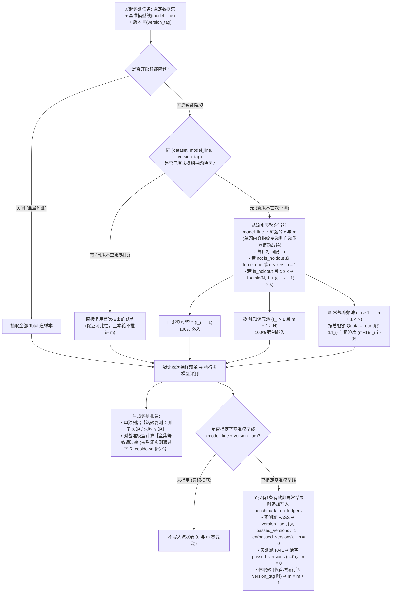

# 常规评测集动态阶梯降频抽取与复测战绩治理设计方案

> **方案版本**：v2.1（业务对齐定稿版）  
> **文档定位**：定义评测平台在执行常规基准评测（[`BenchmarkRunner`](../backend/app/engine/benchmark_runner.py)）时的**动态样本过滤、阶梯降频抽取与复测战绩治理机制**。

---

## 一、 核心设计准则（Core Principles）

1. **固定阶梯冷却间隔 + 紧迫度配额平滑**：
   - 采用**固定阶梯冷却间隔 + 紧迫度配额平滑**，默认连续通过门槛设为 **`x = 3`**（连续 3 个不同版本通过后开始拉长间隔），步长 `s = 1`，最大间隔上限为 `N`（默认 `N = 5`），稳态下熟题池每轮测试量严格收敛于 `熟题总量 ÷ N`。
   - 因存在 `N` 轮触顶强制必测机制，任意熟题最多休眠 `N - 1` 轮必定复测，从算法上保证无“永久休眠盲区”。
2. **留出题（`is_holdout`）源头互斥与降频资格约束**：
   - `is_holdout: bool = False` 作为题目固有属性置于 `BenchmarkSample` 顶层（移出战绩状态，重置战绩不丢失）。
   - **训/测源头隔离**：飞轮对话一旦切题导出至 Benchmark 评测集，源对话自动标记 `exported_to_benchmark = True`，生成的考题标记 `is_holdout = True`；飞轮导出 SFT 训练集时**默认强制排除所有已进评测集的同源对话**。外部导入的纯评测集可在导入时一键标记为 `is_holdout = True`。
   - **非留出题禁止降频**：若某道题 `is_holdout == False`（与训练集同源），其通过表现仅反映记忆背诵，不计入泛化降频（目标间隔恒为 `I = 1`）。
3. **战绩脱离 JSONL，按「单模型线 + 追加式流水表」独立存储**：
   - 数据集 `.jsonl` 保持 100% 纯净只读，避免并发覆写损坏、不同模型线战绩串台及误操作无法回滚。
   - 在 SQLite 新增只追加的评测战绩流水表 `benchmark_run_ledgers`（记录 `task_id, dataset_path, model_line, version_tag, sampled_ids_json, records_json, is_revoked`），按 `(dataset_path, model_line)` 动态聚合每道题的 `c` 和 `m`，支持按 `task_id` 一键撤销单次误操作。
4. **按「已通过版本集合 (`passed_versions`)」计数 + 同版本题单复用 + 单题指纹变更重置**：
   - 开启战绩更新时，每次**仅允许指定 1 条基准模型线（`model_line`）**，且 **`version_tag` 必填**（未指定基准模型则为只读摸底模式，零写入流水）。
   - 维护该题在当前模型线下已通过的不重复 `version_tag` 集合 `passed_versions`，防止候选版本 A、B 交替评测刷高 `c`。
   - **同版本重跑复用题单**：同一 `(dataset_path, model_line, version_tag)` 重跑时，直接复用首次抽出的题单，且不推进休眠题的 `m`，保证同版本多次实验严格可比。
   - **覆盖重导清零 & 单题内容指纹校验**：同名数据集执行覆盖导入（`overwrite`）时自动作废旧战绩流水；同时每条流水明细记录单题内容指纹 `content_hash`（基于 `messages + reference + rubric + regex_constraints`），仅当某道题自身内容被修改时重置该题战绩，追加新题不误伤存量熟题。
5. **熟题复测监控 + 分层折算等效通过率**：
   - 独立统计本轮实测熟题（`c_old ≥ x`）的通过数与失败数，监控模型遗忘/退化率。
   - **全集等效通过率（仅对基准模型突出展示）**：按本轮实测熟题的真实保持率 `R_cooldown` 折算休眠题得分，并在报告中单独列出 **「熟题复测表现（实测数 / 失败数 / 熟题遗忘率）」**。
   - 若用户显式为题目标注了细粒度 `group_key` 并开启可选开关 `enable_group_regression_wakeup`，则在熟题 FAIL 时将同 `group_key` 下的其他休眠熟题下轮唤醒必测（默认关闭，不对通用分类强制保底或连坐）。

---

## 二、 为什么选择「固定阶梯间隔 + 配额错峰」？（纯文本数学推导）

假设熟题池有 `M = 100` 道题，配置最大评测间隔上限 `N = 5`（最多隔 4 次不测，第 5 次必测）：

```text
【方式一：每轮按概率 p = 1/N = 0.2 随机抽 + 第 N 次强制保底】
  设单轮抽中率 p = 0.2，轮空率 q = 1 − p = 0.8，最大上限 N = 5。
  单题两次被测之间的实际平均间隔轮数 E[T] 为：
    E[T] = 1×p + 2×q×p + 3×q²×p + 4×q³×p + 5×q⁴
         = (1 − q^N) ÷ p
         = (1 − 0.8⁵) ÷ 0.2 ≈ 3.36 次
  ➔ 实际每次平均抽出题量 = 100 ÷ 3.36 ≈ 30 道（比预期的 100 ÷ 5 = 20 道多出 50%！）

【方式二：固定阶梯间隔 + 紧迫度配额平滑（本方案采用）】
  当 100 道熟题均达到最大间隔 I_i = 5 时：
    本轮总抽取配额 Quota = ∑ (1 ÷ I_i) = 100 × (1 ÷ 5) = 20 道
  ➔ 配合按轮空紧迫度（Urgency）排队与哈希打散，100 道题在 1 个周期内自动均匀错开，
     稳态下每次精准抽出 20 道（严格等于 总量 ÷ N）。
```

---

## 三、 全链路核心运转流程图



---

## 四、 核心数据结构与算法规范

### 4.1 样本固有属性与战绩流水表分离

#### 1. 样本文件固有属性（`BenchmarkSample`，存于只读 `.jsonl`）
- `id: str`：样本唯一 ID
- `is_holdout: bool = False`：**是否为未进训练集的纯评测留出题**（默认 `False`；飞轮导出评测集锁定源对话不进训练集，或外部导入纯评测集勾选留出标记时为 `True`）
- `group_key: Optional[str] = None`：**可选业务分组键**（仅在显式配置且开启 `enable_group_regression_wakeup` 时参与同组退化唤醒）

#### 2. 战绩追加流水表与聚合状态（存于 SQLite，按 `model_line` 隔离）
- **表 1：`benchmark_run_ledgers`（只追加历史流水表，支持按 `task_id` 撤销）**
  - `id`: 主键
  - `task_id`: 关联评测任务 ID（索引）
  - `dataset_path`: 数据集路径（索引）
  - `model_line`: 基准模型线标识（如 `"qwen2.5-7b-postloan"`，索引）
  - `version_tag`: 模型版本号（如 `"v2.1"`，索引）
  - `sampled_ids_json`: 本次抽出的样本 ID 快照列表（供同版本重跑直接复用）
  - `records_json`: 本次各样本的实测/休眠明细（含 `sample_id, content_hash, status, score, was_cooldown, skipped`）
  - `is_revoked`: 是否已撤销（默认 `False`，误操作或删除任务时标记为 `True` 即可回滚战绩）
  - `created_at`: 时间戳

- **表 2：单题在指定模型线下的内存聚合态（`SampleEvalTracker`）**
  | 字段名 | 类型 | 默认值 | 含义说明 |
  | :--- | :--- | :--- | :--- |
  | `passed_versions` | `List[str]` | `[]` | 当前连续通过周期内已达标的不重复 `version_tag` 集合（防 A/B 版本交替测刷高 `c`）。 |
  | `consecutive_pass` (`c`) | `int` | `0` | 严格等于 `len(passed_versions)`。一旦某版本 FAIL 或题目内容指纹变动，集合清空，`c = 0`。 |
  | `miss_streak` (`m`) | `int` | `0` | 自上次实测以来，已连续轮空的不同 `version_tag` 次数（同版本重跑不累加 `m`）。 |
  | `force_due` | `bool` | `False` | 是否因同 `group_key` 熟题失败而被可选连坐唤醒。 |
  | `last_content_hash` | `Optional[str]` | `None` | 最近一次实测时该样本的内容指纹。 |
  | `last_status` | `str` | `"UNSEEN"` | 最近一次实测状态：`"UNSEEN"` / `"PASS"` / `"FAIL"`。 |
  | `last_score` | `Optional[float]` | `None` | 最近一次实测得分。 |

---

### 4.2 抽取算法（含同版本快照复用与三池分流）

配置参数：
- `pass_threshold_x`（默认 **`x = 3`**）：连续通过 3 个不同版本后开始降频；
- `interval_step_s`（默认 `s = 1`）：每多过 1 个版本，间隔递增 `1`；
- `max_interval_n`（默认 `N = 5`）：最大评测间隔上限。

#### 抽取执行步骤：
1. **同版本题单复用检查**：
   若指定了 `(dataset_path, model_line, version_tag)`，先查询 `benchmark_run_ledgers` 中是否存在该三元组未撤销的抽题快照 `sampled_ids_json`。若存在，**直接返回该题单快照**，并标记 `is_rerun_same_version = True`（后续不推进休眠题的 `m`）。
2. **动态聚合战绩与单题指纹校验**：
   按时间顺序重放当前 `(dataset_path, model_line)` 下未撤销流水，聚合每题的 `passed_versions`、`miss_streak`、`force_due`；若某题当前内容指纹与 `last_content_hash` 不一致，重置该题战绩为初始态。
3. **计算单题目标间隔 `I_i`**：
   ```text
   若 sample.is_holdout == False （非留出题，与训练集同源）：
       I_i = 1
   若 tracker.force_due == True 或 c_i < x：
       I_i = 1
   若 sample.is_holdout == True 且 c_i ≥ x：
       I_i = min(N, 1 + (c_i − x + 1) × s)
   ```
4. **三池分流抽取**：
   - **🔴 必测攻坚池 (`Pool_Active`)**：所有 `I_i == 1` 的样本，100% 入选；
   - **🟡 触顶保底池 (`Pool_HardCap`)**：所有 `I_i > 1` 且 `m_i + 1 ≥ N` 的样本，100% 强制入选；
   - **🟢 常规降频池 (`Pool_RegularCooldown`)**：
     - 计算降频总池（`I_i > 1`）的本轮理论配额：`Quota_cooldown = max(1, round( ∑ (1 ÷ I_i) ))`；
     - 若已入选的触顶题少于 `Quota_cooldown`，按 `(Urgency_i = (m_i + 1) ÷ I_i, m_i, hash_tie_breaker)` 降序从剩余候选降频题中补齐至 `Quota_cooldown` 道。

---

### 4.3 战绩流水写入与重放更新规则

当且仅当用户指定了 **基准模型线（`model_line`）+ 版本号（`version_tag`）+ 参评基准模型（`benchmark_model_id`）**，且该基准模型在本轮至少完成 1 道非 `API_ERROR` 样本时写入 `benchmark_run_ledgers`：

1. **本轮休眠免测样本（`sample_id ∈ Pool_Skipped`）**：
   - 若 `is_rerun_same_version == False`（该 `version_tag` 首次运行）：聚合时 `m_new = m_old + 1`；
   - 若 `is_rerun_same_version == True`（同版本重跑）：不推进 `m`。
2. **本轮抽中实测样本（`sample_id ∈ Pool_Selected`）**：
   - 若基准模型在该题上为 `API_ERROR`：不改变 `passed_versions`、`c`、`m`；
   - 若基准模型在该题上 **达标通过**（`status == "PASS"` 且得分 `≥ min_pass_score`）：
     `passed_versions = union(passed_versions, {version_tag})`，`c = len(passed_versions)`，`m = 0`，`force_due = False`；
   - 若基准模型在该题上 **未达标（`FAIL`）**：
     `passed_versions = []`，`c = 0`，`m = 0`，`force_due = False`（若 `c_old ≥ x` 且开启了 `enable_group_regression_wakeup`，则将同非空 `group_key` 下的其他当前熟题标记 `force_due = True`）。

---

### 4.4 评测报告指标：熟题复测监控与分层折算等效通过率

```text
设：
  Total_dataset       = 数据集总题数
  N_sampled           = 本轮实测总题数
  S_skipped           = 本轮休眠免测熟题数 (Total_dataset − N_sampled)
  N_api_error         = 本轮实测 API 异常题数
  N_valid_sampled     = 本轮实测有效题数 (N_sampled − N_api_error)
  N_passed            = 本轮实测通过总题数

  N_cooldown_tested   = 本轮实测样本中属于熟题池 (c_old ≥ x 且 is_holdout=True) 的有效题数
  N_cooldown_passed   = 本轮实测熟题中通过的题数
  N_cooldown_failed   = N_cooldown_tested − N_cooldown_passed (即：熟题退化/遗忘题数)

1. 本次实测通过率 (Sampled Pass Rate，所有参评模型均展示)
   公式：pass_rate = N_passed ÷ N_valid_sampled × 100%

2. 熟题复测表现与遗忘率 (Cooldown Retention & Regression)
   展示格式：实测熟题 N_cooldown_tested 道 ｜ 通过 N_cooldown_passed 道 ｜ 退化失败 N_cooldown_failed 道
   熟题保持率 R_cooldown = N_cooldown_passed ÷ N_cooldown_tested
   熟题遗忘率 = (1 − R_cooldown) × 100%

3. 全集等效通过率 (Estimated Full Pass Rate，仅对指定基准模型线突出展示)
   • 若 S_skipped == 0：estimated_full_pass_rate = pass_rate
   • 若 S_skipped > 0 且 N_cooldown_tested > 0：
       estimated_full_pass_rate = (N_passed + S_skipped × R_cooldown) ÷ (Total_dataset − N_api_error) × 100%
   • 若 S_skipped > 0 且 N_cooldown_tested == 0（本轮抽中熟题全部 API 异常）：
       estimated_full_pass_rate = None（不输出虚高估算）
```
