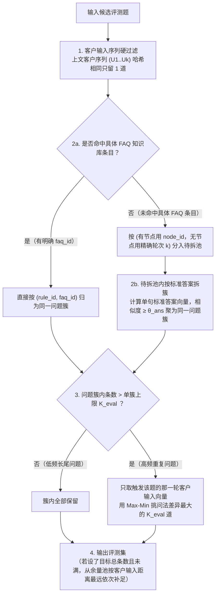
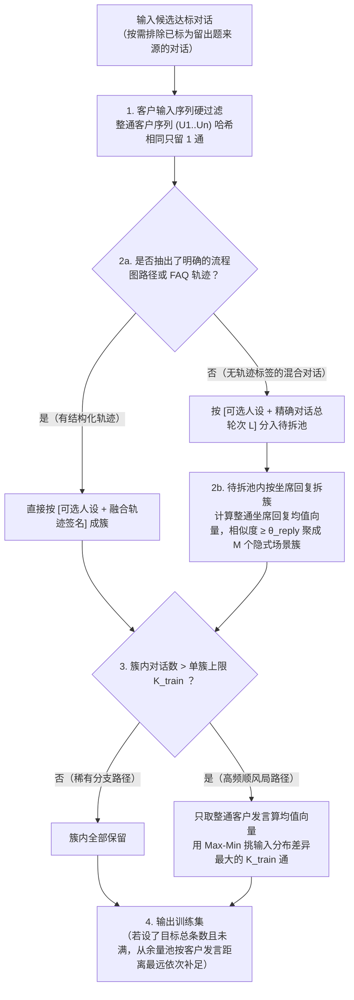
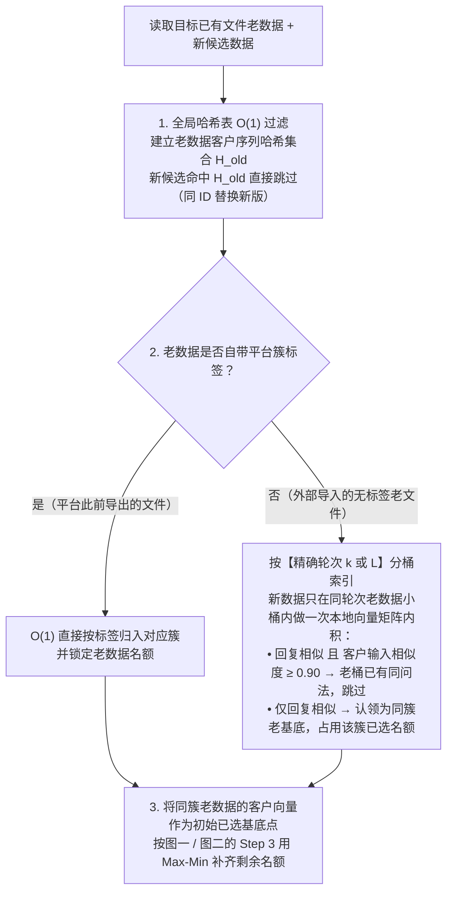

# 评测集与训练集去重及防稀释算法逻辑图（详细备忘版）

> **对应核心实现**：[`backend/app/engine/deduplicator.py`](../backend/app/engine/deduplicator.py)（`DatasetDeduplicator`）、[`backend/app/api/deps.py`](../backend/app/api/deps.py)（`upsert_flywheel_sample`）
>
> **全局前置约定**
> - **样本池按规则隔离**：样本池内仅对同一**规则**（`rule_id`）下客户输入序列完全相同的**对话**做原地更新（基于原对话与修复后对话双哈希 `raw_user_hash` / `remediated_user_hash`，跨规则严格隔离），其余记录全量保留（供后续统计、筛选或其他处理）。
> - **零大模型比对开销**：以下所有去重、拆簇与最大差异挑选，均只使用**字符串 SHA-256 哈希**与**本地预计算向量**（默认 256 维多粒度字符特征向量，支持复用内存中已加载的本地 CPU 模型），不调用大模型。

---

## 一、 评测集生成算法（针对单轮评测题）

### 图一详细条件备忘说明（防遗忘）

1. **Step 1 客户输入序列硬过滤**：
   - 提取这道评测题 `messages` 里从第 1 轮到最后一轮**客户依次说的全部原话 `(U1, U2, ..., Uk)`**（外呼第 1 轮无客户说话时为系统补位的接通触发语），去除空格与标点差异后算 SHA-256 哈希。
   - **为什么看 `(U1..Uk)` 序列而不只看最后一句 `Uk`**：客户最后一句常为 `"是的"`、`"好的"`，只看最后一句会把不同业务环节的确认回答误删；看完整客户序列则能精准拦住完全相同的对话前文。
2. **Step 2a 走「否（未命中具体 FAQ 条目）」分支的 3 种具体情况**：
   - **情况 ①（同节点下的多种流程/红线错误）**：开启了流程 SOP，没触发 FAQ。例如都在「节点 2」，有的评测题错在漏问序列号，有的错在违反了系统提示词里的隐含禁令（无规则编号），有的错在答错了日常闲聊——它们虽然都在 `node_id = 节点2`，但不是同一种错误，不能混为一簇，所以先进 `node_id` 待拆池。
   - **情况 ②（超出 FAQ 知识库范围的提问）**：开启了 FAQ 质检，客户确实问了业务问题，但规则配置的 FAQ 知识库里搜不到对应条目（无具体 `faq_id` 或记为 `FAQ_OOD`，坐席需按兜底话术拒答引导），先进所在 `node_id`（未开 SOP 则按 `精确轮次 k`）待拆池。
   - **情况 ③（无规则外部导入 / SOP 与 FAQ 开关全关）**：外部直接导入的评测集未绑定任何规则，或者规则里既没开流程图也没开 FAQ，没有任何 `faq_id` 和 `node_id` 标签，直接按**精确轮次号 `k`**（即上文共有几轮）分入待拆池；不同轮次偏移代表不同长度的上下文分布，彼此独立不合并。
3. **Step 2b 待拆池内按标准答案向量拆簇**：
   - 对同一个待拆池内的评测题，把**单句标准答案 `reference`**（若外部评测题无 `reference` 则取评分细则 `rubric`）编码为本地向量。
   - 答案余弦相似度 `≥ θ_ans`（默认 `0.82`）归入同一个**问题簇**（说明底层错误原因与标准应对相同）；相似度 `< θ_ans` 自动拆成不同的问题簇（各自拥有独立的 `K_eval` 配额，绝不互相挤占）。
4. **Step 3 簇内 Max-Min 挑选**：
   - 当同一个问题簇候选数超过 `K_eval`（默认 `5`）时，说明答案差不多、考的是同一件事，此时计算**最后一轮客户输入 `Uk`** 的向量：先选离簇中心最近的 1 道典型问法作种子，再循环挑与已选集合最大余弦相似度最小（问法差异最大）的评测题，直到选够 `K_eval` 道。

---

## 二、 训练集生成算法（针对整通对话）

### 图二详细条件备忘说明（防遗忘）

1. **可选字段自动缺省规则**：
   - 对练产生的对话有 `客户人设 ID`；外部导入的真实对话或默认场景（`default` / `manual_playground` / `row_*`）没有预设人设，该字段统一留空（`""`），不影响后续分组。
2. **Step 2a 走「是（有结构化轨迹）」时的融合轨迹签名写法**：
   - **SOP 开 + FAQ 开**：将连续同节点自旋压缩后，把触发的 `faq_id` 挂在当时所处的节点上。例如 `s1 → s2[faq_1] → s3` 与 `s1 → s2 → s3[faq_1]` 与 `s1 → s2 → s3` 签名不同，属于 **3 个独立细簇**。
   - **SOP 开 + FAQ 关**：主干节点路径，如 `s1 → s2 → s3`。
   - **SOP 关 + FAQ 开（且该通对话触发过至少 1 个 FAQ）**：按对话中先后触发的 FAQ 排列，如 `FAQ_SEQ:[faq_1 → faq_5]`。
3. **Step 2a 走「否（无轨迹标签的混合对话）」的 3 种具体情况（解决 80% 未分组防误砍）**：
   - **情况 ①**：只开了 FAQ 没开 SOP，而这 80% 的对话全程都是正常业务办理、没问任何 FAQ；
   - **情况 ②**：规则里 SOP 和 FAQ 两个开关都没开；
   - **情况 ③**：从外部直接导入的纯对话训练集，根本没跑过规则质检，没有任何规则、人设、节点或 FAQ 标签。
   - **为什么必须进 Step 2b 拆簇**：以上情况落入的 `精确总轮次 L` 是一个混合大池（800 通对话里可能包含查物流、改地址、退货等 30 种不同业务）。Step 2b 提取每通对话里**所有坐席回复算均值向量**，按相似度 `≥ θ_reply`（默认 `0.82`）自动聚成 `M` 个隐式业务簇——有 30 种业务应对就拆出 30 个簇，每簇独立享有 `K_train`（默认 `20`）名额，绝不会把 80% 的未分组数据当成 1 个组砍成 20 条。
4. **Step 3 客户输入分布向量怎么算**：
   - 只提取整通对话里的**全部客户发言 `(U1, U2, ..., Un)`**，每句算本地向量后取平均值并归一化（既防止整篇几千字超出向量模型 512 长度被截断，又剔除了坐席固定流程套话的干扰，专门衡量客户输入场景差异）。

---

## 三、 追加合并至「已有训练集 / 评测集」低复杂度防冲突图

> **为什么不会退化成慢速的全库两两比对？**
> 1. **平台自产文件 `O(1)` 直接归位**：平台导出的文件在元数据保留簇签名（`dedup_cluster_key`）并附带预计算原子旁路向量缓存（`.dedup_cache.json`，指纹绑定 `encoder_tag`），合并时直接 `O(1)` 落回对应簇占位，无需跨库扫描。
> 2. **外部无标签老文件按「精确轮次」分桶隔离**：因为已约定**「不同轮次属于不同长度分布，不合并」**，第 `k` 轮的新评测题（或总长 `L` 轮的新对话）**只需和老文件里同样是第 `k` 轮（或同样 `L` 轮）的那一小桶老数据做本地矩阵内积**；10,000 条老数据分摊到二三十个轮次桶后，单桶仅几百条，CPU 矩阵内积耗时在毫秒级。

