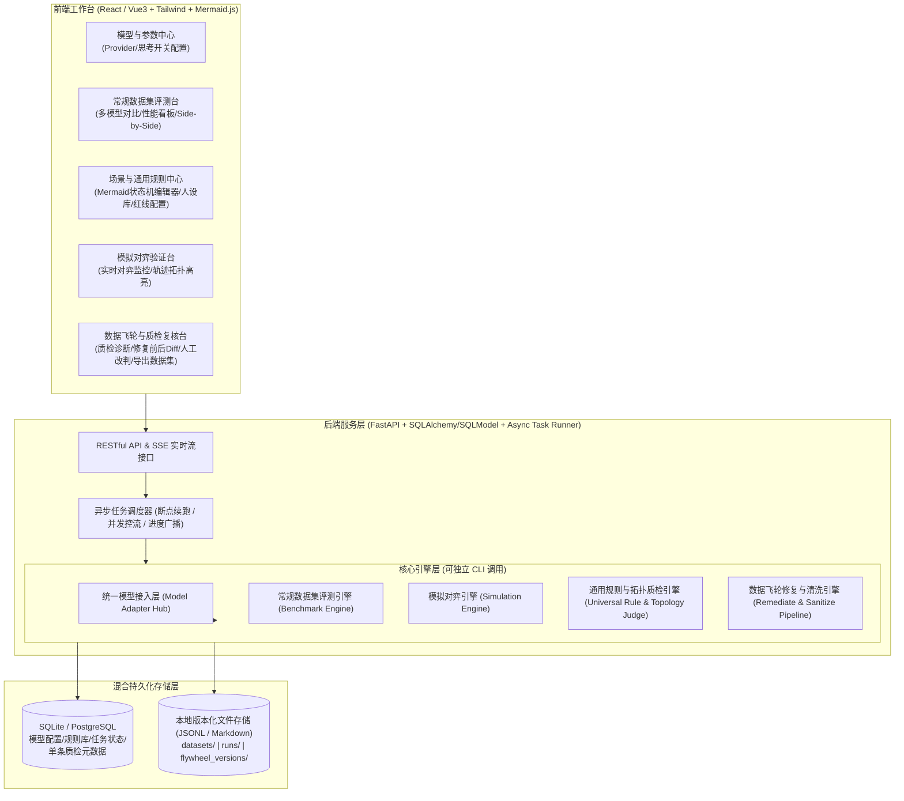
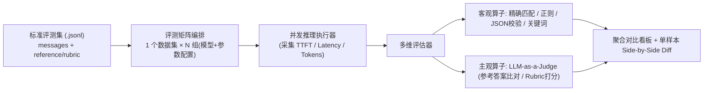
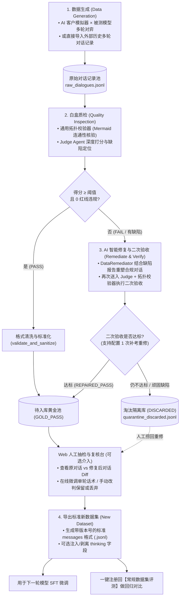

# 通用大模型测试管理与数据飞轮平台设计方案 (DESIGN_PLAN)

> **文档状态**: v1.0 架构定稿（待审阅确认后实施目录重构与编码）  
> **最后更新**: 2026-11-04  
> **演进基座**: 基于早期业务原型脚本解耦升级为通用测试管理与数据飞轮平台

---

## 一、 平台定位与核心目标

本平台旨在打造一套**前后端分离、业务无关、配置驱动的通用大模型测试管理与数据飞轮平台（Eval & Data Flywheel Platform）**。

核心支撑两大闭环能力：
1. **常规数据集评测（Benchmark & 横向对比评测）**：接入任意 OpenAI Completion/Chat 兼容模型，灵活配置思考开关、温度等推理参数，在同一标准数据集上横向对比多模型/多配置在**推理性能、客观规则、主观裁判打分**三个维度的表现，支持单样本并排（Side-by-Side）Diff 分析。
2. **微调模型验证与数据飞轮（AI 驱动模拟对话 → 质检 → 修复/丢弃 → 新数据集）**：针对对话机器人（Chatbot / Task Bot）场景，通过**通用规则配置协议（Mermaid 状态机流程图 + 规则检查点 + 客户人设剧本）**驱动双 Agent 自动对弈测试，并对产生的对话记录执行“**白盒质检 → 缺陷 AI 重塑修复与二次验收 / 顽固样本丢弃隔离 → 人工抽检复核 → 导出标准 `messages` 格式新数据集**”的全生命周期治理，生成的新数据集可直接用于下一轮微调或回流至常规数据集评测。

---

## 二、 总体技术架构



### 技术栈选型
- **后端框架**：Python 3.10+ / FastAPI（提供 REST API 与 Server-Sent Events 流式进度推送），核心引擎保持无 Web 依赖的纯 Python 包结构，既可由 FastAPI 调度，也可直接通过 CLI 命令运行。
- **数据存储**：
  - **结构化元数据（SQLite，可无缝切换 PostgreSQL）**：管理系统配置、模型实例、场景规则定义、评测任务记录、单条样本评分与人工审核状态。
  - **大文件资产（本地文件系统规范化目录）**：存储原始数据集、模拟对话原始记录、修复后数据集（标准 `.jsonl`）及导出的 Markdown 评估报告。
- **前端交互**：React（或 Vue 3）+ Ant Design / Shadcn UI + ECharts（性能雷达图与分布对比）+ Mermaid.js（状态机流转轨迹可视化高亮）+ Monaco Diff Editor（修复前后多轮对话逐轮 Diff 对比与在线编辑）。

---

## 三、 核心模块详细设计

### 3.1 统一模型接入层（Unified Model Adapter Hub）

遵循**“对外多适配器兼容，对内单一标准协议”**原则，系统中所有模型角色（**被测模型 Target、模拟客户 Client、评测裁判 Judge、数据修复专家 Remediator**）均从统一的模型注册中心选取并调用。

#### 1. 内部统一标准协议（Canonical Internal Schema）
- **统一请求对象 (`UnifiedChatRequest`)**：
  ```json
  {
    "model_id": "qwen3-32b-sft-v2",
    "messages": [
      {"role": "system", "content": "..."},
      {"role": "user", "content": "..."}
    ],
    "config": {
      "temperature": 0.3,
      "top_p": 0.9,
      "max_tokens": 4096,
      "repetition_penalty": 1.05,
      "thinking_enabled": true,
      "thinking_level": "HIGH",
      "extra_body": {}
    }
  }
  ```
- **统一响应对象 (`UnifiedChatResponse`)**：
  ```json
  {
    "content": "剥离思考过程与通道前缀后的纯净回复正文",
    "thinking": "提取出的模型思考链内容（若未开启或无思考则为空字符串）",
    "raw_output": "模型原始未清洗输出（供排障审计）",
    "usage": {
      "prompt_tokens": 512,
      "completion_tokens": 380,
      "thinking_tokens": 260,
      "answer_tokens": 120,
      "total_tokens": 892
    },
    "metrics": {
      "ttft_ms": 240.5,
      "total_latency_ms": 1850.2,
      "tokens_per_second": 48.2
    }
  }
  ```

#### 2. 多协议适配器与思考模式（Thinking Mode）归一化解耦
不同模型后端对“思考开关”的入参和返回格式不同，由具体 `ProviderAdapter` 负责转换与清洗：
| 适配器类型 | 思考开关入参映射策略 | 思考链 (`thinking`) 与正文 (`content`) 分离解析策略 |
| :--- | :--- | :--- |
| **OpenAI / DeepSeek 标准兼容适配器** | 映射为 `reasoning_effort` (`low`/`medium`/`high`) 或透传 `extra_body` | 优先读取 `message.reasoning_content`；若嵌在正文中则正则剥离 `<think>...</think>` |
| **vLLM / SGLang 开源推理适配器** | 映射为 `chat_template_kwargs: {"enable_thinking": true/false}` | 自动分离 `reasoning_content` 或 `<think>` 标签内容，计算思考 Token 占比 |
| **Harmony / 微调自研格式适配器** | 支持特定微调模板参数及 Colab 隧道重试机制 | 内置 `clean_harmony_prefix`，按 `<\|channel\|>thought` 与 `<\|channel\|>final` 切分思考与最终回复 |
| **Vertex AI (Gemini) 适配器** | 映射为 `ThinkingConfig(thinking_level=...)` | 复用现有 ADC 免密鉴权与 Windows 注册表代理感知能力，提取 Gemini thoughts 部分 |

---

### 3.2 模块一：常规数据集评测引擎（Standard Dataset Benchmark）

用于对比不同基座模型、不同微调 Checkpoint，或同一模型在不同参数（如**开启思考 vs 关闭思考**、不同温度）下的综合表现。



#### 1. 标准评测数据集格式
每行一条 JSON（兼容单轮与多轮上文，支持正反向正则约束 `regex_constraints` 与样本级 `max_new_tokens` 控制）：
```json
{
  "id": "gen_004",
  "category": "通用百科常识",
  "sub_category": "计算机网络",
  "difficulty": "easy",
  "source": "MMLU计算机基础",
  "max_new_tokens": 64,
  "messages": [
    {"role": "user", "content": "请简短回答：HTTP状态码 404 和 502 分别代表什么含义？"}
  ],
  "reference": "404 表示未找到请求的资源（Not Found）；502 表示错误网关（Bad Gateway），即网关或代理服务器从上游服务器收到无效响应。",
  "rubric": "准确说明 404 为未找到资源/Not Found，502 为网关错误/Bad Gateway。",
  "regex_constraints": [
    "未找到|不存在|Not Found",
    "网关|上游|Bad Gateway",
    "!星云智联|售后专员"
  ]
}
```
> **字段说明**：
> - `rubric`: 字符串类型的 LLM 裁判评分细则（同时向下兼容旧版 `RubricConfig` 字典）；
> - `regex_constraints`: 正则约束数组。普通字符串代表**正向必配正则**（未命中判 FAIL）；以 `!` 开头的字符串（如 `"!星云智联|售后专员"`）代表**反向违禁正则**（命中即判 FAIL，专门用于检测微调模型在通用题上的灾难性遗忘与身份串台）。

#### 2. 对比评测指标体系
1. **推理工程性能指标**：
   - 平均/P90/P99 端到端耗时（Total Latency ms）、首字延迟（TTFT ms）、生成吞吐率（Tokens/s）；
   - 平均输出长度、**思考 Token 占比**（思考 Token 数 ÷ 总输出 Token 数，直观评估开启思考带来的延迟与成本开销）。
2. **客观规则指标**：
   - 必含词命中率、违禁词触发率（红线零容忍）、正则表达式匹配率、JSON Schema 结构合法率。
3. **LLM 裁判评分指标**：
   - 基于 `reference`（标准参考答案）和 `judge_criteria`（评分细则），由指定的 Judge 模型输出 `0~100` 评分与扣分理由。
4. **可视化对比视图**：
   - **宏观汇总表**：N 组模型配置在各分类下的平均分、通过率、平均耗时、Token 成本对比；
   - **微观 Side-by-Side 视图**：同一道题下，并排展示模型 A（如开启思考）与模型 B（如关闭思考）的思考过程、最终回复、耗时差异及裁判点评。

---

### 3.3 模块二：微调模型验证与数据飞轮（Simulated Dialogue & Data Flywheel）

将业务特定逻辑抽离为**通用对话机器人验证与数据治理引擎**。接入任何新场景只需编写或配置一份**通用规则配置（Rule & SOP Config）**。

#### 1. 通用规则配置协议（Universal Rule & SOP Schema）
一个对话测试项目（Project/Scenario Suite）由一份结构化配置定义，解耦所有业务硬编码：
```json
{
  "rule_id": "demo_after_sales_v1",
  "project_name": "星云智联智能设备售后回访客服机器人",
  "bot_config": {
    "system_prompt": "你是星云智联售后客服中心的专业客服专员...",
    "initiator": "user",
    "max_turns": 80,
    "closing_keywords": ["祝您生活愉快，再见", "祝您使用愉快，再见", "再见！"]
  },
  "topology_sop": {
    "enabled": true,
    "mermaid_graph": "graph TD\n  N1_1[下单人身份核实] --> N2_1[设备使用情况回访]...",
    "node_id_pattern": "[A-Za-z0-9_]+",
    "entry_nodes": ["N1_1"],
    "terminal_nodes": ["N4_1", "N1_4", "N1_5"],
    "allow_self_loop": true,
    "allow_slot_shortcut": true,
    "stage_groups": [["N2_1", "N2_2", "N2_3", "N2_4"]]
  },
  "inspection_rules": {
    "pass_score_threshold": 85,
    "global_redlines": [
      "向非下单人本人透露具体订单收货地址或账号隐私信息",
      "私自承诺流程图未授权的免费换新或额外补偿政策"
    ],
    "node_checkpoints": {
      "N3_1": {
        "required_elements": ["7天无理由退换条件", "1年质保周期", "质量问题免运费规则"],
        "fatal_if_skipped_after": ["N2_1", "N2_2"]
      }
    },
    "custom_rubric": "语气需专业克制，客户已主动交代的槽位信息严禁机械重复反问。"
  },
  "remediation_config": {
    "target_turn_range": [30, 80],
    "output_format": {
      "inject_empty_thinking": false,
      "require_assistant_ending": true,
      "strict_alternating_roles": true
    }
  }
}
```
> **通用性设计亮点**：
> - 当 `topology_sop.enabled = true` 时，自动启用通用化的 `TopologyValidator`（按通用节点正则解析任意 Mermaid `graph TD/LR` 流程图，校验从 `entry_nodes` 到 `terminal_nodes` 的有向连通性、合法自旋与条件顺承）。
> - 当 `topology_sop.enabled = false` 时，自动退化为无状态机的通用多轮对话质检（仅依据 `global_redlines` 与 `custom_rubric` 评判），轻松适配开放式顾问、导购、陪伴类对话机器人。

#### 2. 模拟对话与数据飞轮全链路流转（四步闭环）



#### 3. 产出的新数据集（`messages` 格式）标准规范
最终沉淀的数据集严格遵循最通用的 OpenAI SFT `messages` JSONL 格式（每行一条完整多轮或切片对话），支持导出时按需配置：
```json
{
  "id": "flywheel_v1.2_00042",
  "metadata": {
    "source_run_id": "run_20261104_160000",
    "scenario_id": "case_03_refuse_contact",
    "origin_status": "REPAIRED_PASS",
    "initial_score": 45,
    "final_score": 94,
    "node_trajectory": ["N1_1", "N2_1", "N2_2", "N3_1", "N4_1"],
    "reviewer": "auto_verified"
  },
  "messages": [
    {"role": "system", "content": "你是星云智联售后客服中心的专业客服专员..."},
    {"role": "user", "content": "喂，你好。"},
    {"role": "assistant", "content": "您好，这边是星云智联售后客服中心专员..."}
  ]
}
```
- **导出纯净训练版选项**：支持一键导出仅包含 `{"messages": [...]}` 顶层键的纯净版 JSONL（供 LLaMA-Factory / Unsloth / Swift 等框架直接读取），并可按开关控制是否为 `assistant` 轮次附加 `"thinking": ""` 字段。

---

## 四、 核心模块演进映射表

在架构演进中，各核心模块按以下职责分层实现：

| 原始职责域 | 核心可复用能力 | 目标模块位置与改造点 |
| :--- | :--- | :--- |
| `target_client` + `vertex_gemini_adapter` | HTTP 重试、Harmony 前缀剥离、Windows 代理自动感知、长连接无读超时限制 (`read=None`)、429 指数退避 | 合并抽离至 `backend/app/adapters/`：拆分为 `OpenAICompatibleAdapter`、`HarmonyAdapter`、`VertexGeminiAdapter`，统一返回 `UnifiedChatResponse` |
| `sop_manager` | `TopologyValidator`（Mermaid 有向图解析、自旋/条件顺承/断路判定算法） | 迁入 `backend/app/engine/topology.py`：移除固定节点正则硬编码，改为从通用规则配置读取 `mermaid_graph`、`entry_nodes`、`terminal_nodes` |
| `client_agent` | 客户角色扮演 Prompt 构建、流式输出与思考度控制 | 迁入 `backend/app/engine/simulator.py`：解除特定业务场景硬编码，改为读取场景配置中的角色背景与目标指令，通过统一 Adapter 调用 |
| `judge_agent` | 白盒拓扑 + 节点检查点双重质检 Prompt 与 JSON 解析器 | 迁入 `backend/app/engine/judge.py`：支持“通用规则+Mermaid”质检与“常规评测集 Rubric”打分两种模式 |
| `data_remediator` | 缺陷对话端到端重塑 Prompt、`validate_and_sanitize_format` 格式校验引擎 | 迁入 `backend/app/engine/remediator.py`：将 `DEFAULT_SYSTEM_PROMPT` 与 `"thinking": ""` 注入逻辑改为可配置参数 |
| 批处理与调度脚本 | 并发线程池调度、`original_idx` 断点续跑、边跑边落盘、二级漏斗补考淘汰机制 | 封装为 `backend/app/services/flywheel_service.py` 与 `benchmark_runner.py`，同时提供 CLI 入口供命令行直接调用 |
| 场景规则与剧本配置 | 业务外呼完整规则与压力用例 | 转化为用户自定义 JSON 配置模板，本地持久化存储在 `data/rules/` 与 SQLite |

---

## 五、 分阶段实施路线图（Roadmap）

1. **阶段一：核心引擎解耦与统一模型层构建（Core & Adapter Hub）**
   - 实现 `UnifiedChatRequest` / `UnifiedChatResponse` 与多模型适配器（支持思考开关映射与思考内容分离）；
   - 将 `TopologyValidator`、`JudgeAgent`、`ClientAgent`、`DataRemediator` 改造为通用规则配置驱动，并通过通用 JSON 配置模板验证通过。
2. **阶段二：常规数据集评测模块与数据飞轮流水线服务化（Backend & Storage）**
   - 基于 FastAPI + SQLite 搭建后端服务，实现模型管理、规则集管理、数据集版本管理接口；
   - 实现常规数据集多模型并发对比引擎（含性能指标采集、规则算子、Judge 算子）；
   - 实现模拟对弈与“生成 → 质检 → 修复/二次质检/丢弃 → 导出新数据集”异步任务流水线（保留断点续跑能力）。
3. **阶段三：Web 可视化管理工作台开发（Frontend Workbench）**
   - 开发模型配置页、常规评测对比看板（含 Side-by-Side 视图）；
   - 开发通用规则与 Mermaid 状态机配置页、模拟对弈监控页；
   - 开发数据飞轮质检复核台（含修复前后对话 Diff 编辑器、人工改判与数据集版本导出）。
