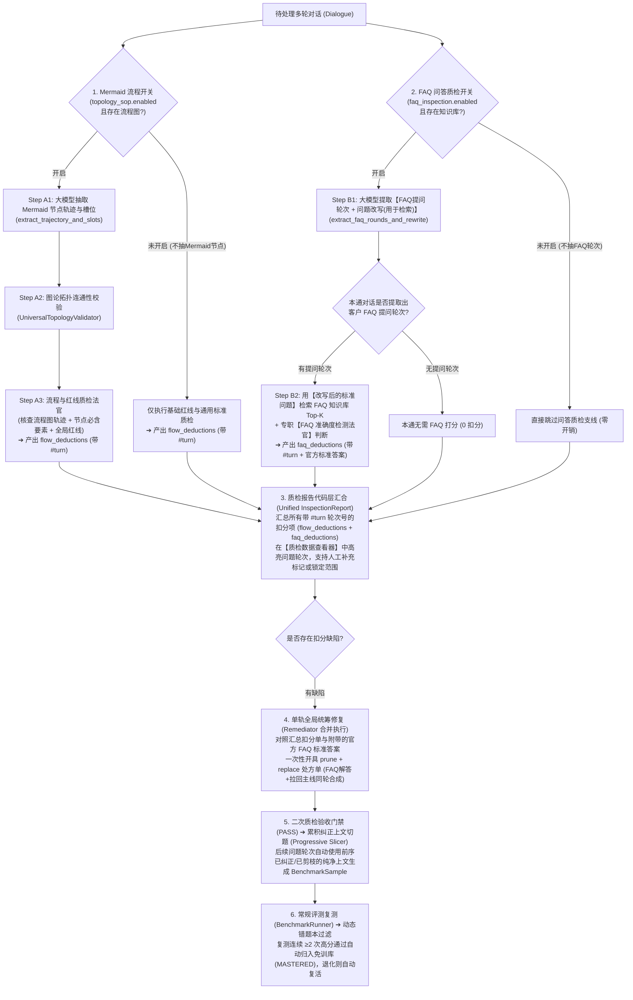

# 双轨并行质检（Mermaid 流程 ∥ FAQ 问答）、累积上文切题与动态免训闭环设计方案

> **文档定位**：本文档总结并规范了平台下一阶段的核心演进方向，旨在解决 **“多轮飞轮数据如何转化为常规评测集”**、**“非流程 FAQ 问答如何与存量业务知识库打通并修复”**、**“实时对练与质检修复如何解耦协同”** 以及 **“如何用复测掌握度替代静态去重实现自动免训”** 四大核心命题。

---

## 一、 核心架构演进总览（Core Paradigm Shifts）

| 演进维度 | 传统做法 / 历史痛点 | 下一代优化架构准则（本方案） |
| :--- | :--- | :--- |
| **1. 对练与质检复核边界** | 试图在实时对练中途打断做干预，或跨多个页面跳转触发整篇盲修，链路割裂。 | **职责解耦，复核聚拢**：实时对练只管原汁原味暴露问题；所有问题定位、人工微调标记、靶向修复与切片转化，统一收敛在 **「质检数据查看/复核视窗」** 内完成。 |
| **2. 流程与 FAQ 质检机制** | 规则中心仅有流程图而无 FAQ 库，或将所有规则塞入同一 Prompt 导致注意力稀释与漏检。 | **入口双开关守门 + 分检合修**：顶层并列判断「Mermaid 开关」与「FAQ 问答开关」（未开启则绝不偷跑对应抽取）；**质检阶段双轨独立并行专精**，**修复阶段单轨合并全局统筹**。 |
| **3. FAQ 轮次识别与修复标准** | 靠代码硬编码规则筛问句易漏判，口语原话直接检索召回率低；修复时易引发下文因果断裂。 | **大模型提取（提问轮次 + 问题改写）+ 三段式拉回**：由大模型提取客户 FAQ 提问轮次并完成 **问题改写（Query Rewrite，用于知识检索）**；修复严格执行 **「官方口径解答 (Answer) ➔ 承接过渡 (Bridge) ➔ 拉回当前 SOP 节点提问 (Resume)」**。 |
| **4. 飞轮多轮数据转评测集** | 完整 SFT 对话以 `assistant` 结尾且无判分标尺，无法直接测；或切题时沿用了前序错误上文。 | **唯轮次号 (`turn`) 锚定 + 累积纠正上文切题**：砍掉无法穷举的预定义 `defect_type`；按时间轴从前往后扫描，**后续缺陷轮次的评测上文强制使用前面已 `replace` 纠正、已 `prune` 剪枝后的纯净黄金上文**。 |
| **5. 评测与训练样本去重过滤** | 靠节点粗暴分桶、算文本/向量相似度或大模型两两比对，极易在“一字之差语义相反”上误判。 | **基于复测战绩的动态错题本（Mastery-Based Filtering）**：放弃静态猜重复！以被测模型实测表现为唯一真理——**复测连续 ≥ 2 次高分通过自动免训归档（`MASTERED`）**，未过或摇摆题持续留在必训攻坚池。 |

---

## 二、 全链路核心架构流程图（入口双开关按需触发 + 分检合修 + 动态免训）



---

## 三、 四种业务开关组合工况矩阵

顶层双开关相互独立、按需触发，适配从纯流程采集到纯被动客服问答的全部业务形态：

| 业务配置工况 | Mermaid 轨道执行动作 | FAQ 问答轨道执行动作 | 典型适用业务场景 |
| :--- | :--- | :--- | :--- |
| **工况 1：仅开 Mermaid，不开 FAQ**<br>(`Mermaid=ON`, `FAQ=OFF`) | 抽取 Mermaid 节点轨迹 ➔ 拓扑校验 ➔ 流程与红线质检 | **完全不触发**（不提取 FAQ 轮次、不查库、不调 FAQ 法官） | 纯流程信息采集型外呼（无复杂政策答疑，按图索骥收集槽位） |
| **工况 2：不开 Mermaid，仅开 FAQ**<br>(`Mermaid=OFF`, `FAQ=ON`) | **不抽取 Mermaid 节点**，仅做基础红线与服务态度质检 | 提取 `FAQ提问轮次 + 问题改写` ➔ 检索知识库 Top-K ➔ 专职 FAQ 法官判准确度 | 纯被动客服答疑 / 政策咨询机器人（无固定 SOP 流程图，核心考知识库问答准确度） |
| **工况 3：双轨全开**<br>(`Mermaid=ON`, `FAQ=ON`) | 抽取 Mermaid 节点 ➔ 拓扑校验 ➔ 流程与红线质检 | 提取 `FAQ提问轮次 + 问题改写` ➔ 查库 Top-K ➔ 专职 FAQ 法官判准确度（**与左轨并行**） | 复杂多环节售后/政企咨询外呼（既有完整 SOP 主线，客户又随时插播问政策 FAQ） |
| **工况 4：双轨全关**<br>(`Mermaid=OFF`, `FAQ=OFF`) | **不抽取 Mermaid 节点**，仅做基础红线与通用 Rubric 质检 | **完全不触发** | 极简通用对话测试（仅检查有无违禁词与基本礼貌） |

---

## 四、 核心模块详细设计规范

### 4.1 模块一：FAQ 问答质检支线（配置契约、问题改写检索与专职法官）

#### 1. 规则中心配置契约（`FAQInspectionConfig`）
在 [`backend/app/schemas/rule.py`](../backend/app/schemas/rule.py) 的 `UniversalRuleSchema` 中，新增与 `topology_sop: TopologySOPConfig` 对称的问答质检配置：
- `enabled: bool = False`：问答质检总开关；
- `knowledge_base: List[FAQItem] = []`：场景挂载的 FAQ 知识库列表，每项含：
  - `id: str`（如 `"FAQ_001"`）
  - `question: str`（标准问题及常见相似问）
  - `answer: str`（官方唯一标准回答口径）
  - `category: Optional[str]`（业务分类标签）
- `top_k: int = 3`：单次提问检索召回的最大候选 FAQ 数量；
- `fallback_policy: str`：超纲问题（知识库未覆盖）的安全兜底规范（如引导联系官方售后热线或通过官方 App 查询）；
- `faq_judge_prompt_template: Optional[str] = ""`：专职 FAQ 准确度检测提示词模板（支持在规则中心同流程质检 Prompt 一样在线调试与实测）。

#### 2. Step B1：大模型提取「FAQ 提问轮次 + 问题改写（用于检索）」
- **为什么不用代码规则筛？** 客户口语提问常无问号、常与回答槽位夹杂在同一句话中（如*“是我本人，对了你们这个要是七天内我发现质量问题退换还收运费吗”*），且包含大量指代（如*“那这个怎么弄”*）。
- **提取与改写合二为一**：仅当 `faq_inspection.enabled == True` 且 `knowledge_base` 非空时，调用轻量大模型扫描对话，一次性输出：
  ```json
  {
    "faq_rounds": [
      {
        "user_turn": 13,
        "assistant_turn": 14,
        "raw_user_question": "对了你们这个要是七天内我发现质量问题退换还收运费吗",
        "rewritten_query": "智能设备七天内质量问题退换货运费承担标准与退换流程"
      }
    ]
  }
  ```
- **精准检索**：系统使用大模型结合上下文消解指代后生成的 **`rewritten_query`（改写后的标准检索词）** 去匹配 `knowledge_base`，召回 Top-K 条官方 FAQ 标准知识。若 `faq_rounds` 为空数组 `[]`，问答质检轨道直接满分结束，无需调用下一步的 FAQ 质检法官。

#### 3. Step B2：专职「FAQ 准确度检测角色」裁决
- **输入极简聚焦**：无需输入完整长对话与 Mermaid 流程图，仅输入提取出的问答轮次上下文（`user_turn` ➔ `assistant_turn`）、超纲兜底规范 `fallback_policy` 以及检索召回的 Top-K 官方 FAQ 条目。
- **核心核查职责**：
  1. **事实一致性**：核查坐席回答中的金额、费用、时效、条件、办理路径是否与命中的官方 FAQ 标准答案 100% 一致；
  2. **超纲防幻觉**：若检索出的候选 FAQ 均与客户问题无关（属知识库未覆盖的超纲问题），核查坐席是否严格执行了 `fallback_policy` 安全兜底，严惩凭空编造政策；
- **输出结构（带精确 `turn` 与 `reference_answer`）**：
  ```json
  {
    "faq_deductions": [
      {
        "turn": 14,
        "item": "FAQ问答准确度 [FAQ_001: 七天退换货政策]",
        "points": 15,
        "reason": "客户询问质量问题退换是否收运费，官方规定由商家承担往返运费，但坐席错误回答需买家自费",
        "matched_faq_id": "FAQ_001",
        "reference_answer": "因产品质量问题申请7天内退换货，往返运费由商家承担，不收取任何额外手续费。"
      }
    ]
  }
  ```

---

### 4.2 模块二：「分检合修」协同机制与三段式 FAQ 修复准则

1. **为什么质检要“分”而修复必须“合”？**
   - **质检宜分**：流程核查（看拓扑与节点必含项）与 FAQ 核查（逐字比对知识库政策）认知模式不同，拆分为两条独立并行支线可彻底消除大模型注意力稀释，结束后仅在代码层将 `flow_deductions` 与 `faq_deductions` 合并入 `InspectionReport.deductions`。
   - **修复必合**：在 [`UniversalDataRemediator`](../backend/app/engine/remediator.py) 执行修复时，同一个轮次 `#t` 往往同时承担 **“解答客户刚刚插播的 FAQ”** 与 **“把话头拉回当前 SOP 节点继续提问”** 两项任务；且 `prune`（剪枝）与 `replace`（替换）需要统筹上下文因果关系。因此修复必须在**单次推理**中汇总所有缺陷统一开具处方单。
2. **非流程 FAQ 的「三段式」修复铁律（Answer ➔ Bridge ➔ Resume）**：
   - 在严格遵守 **“客户原话绝对冻结 (`freeze_user_input=True`)”** 的前提下，针对带有 `reference_answer` 的 FAQ 错误轮次 `#t`，修复模型在使用 `replace` 工具改写坐席话术时必须合成三段：
     - **第一段（Answer 精准解答）**：严格依据质检透传过来的 `reference_answer` 官方口径解答客户疑问（事实零篡改）；
     - **第二段（Bridge 自然过渡）**：使用*“跟您解释清楚后，也回到刚才跟您核实的事项……”*等过渡语；
     - **第三段（Resume 拉回主线）**：抛出当前所处 SOP 节点的业务提问，确保与下一轮 `#(t+1)` 客户的真实原话回答严丝合缝咬合，杜绝“答非所问”的因果断裂！

---

### 4.3 模块三：全自动评测集生成 —— 累积纠正上文切片算法（Progressive Context Slicer）

1. **去枚举化，唯轮次号（`turn`）锚定**：
   - 彻底摒弃无法穷举且破坏通用性的 `defect_type` 枚举定义；
   - 全链路仅靠纯数字轮次号 `#turn` 穿针引线：质检报告指出哪个 `#turn` 扣了多少分（`points`）及原因（`reason`），修复处方单指出哪些轮次被 `prune`（成对剪枝）、哪些轮次被 `replace`（就地替换）。
2. **质量门禁与靶点锁定**：
   - 仅当样本修复后通过二次质检验收（`verified_eval.verdict == "PASS"`）时，才允许切题；
   - `prune` 剪除的冗余轮次仅做上文净化，不单独生成考题；凡被执行 `replace` 替换修复的坐席轮次 `#t`，自动锁定为评测切片靶点。
3. **累积纠正上文步进算法（Progressive Corrected Context）**：
   - 维护动态上文栈 `clean_prefix = [system_msg]`，按原始轮次 `i = 1 ➔ N` 顺序扫描：
     - 若轮次 `#i` 已被 `prune` 剪除：直接跳过，绝不进入后续题目的上文；
     - 若轮次 `#i` 为 `user`：原样推入 `clean_prefix`；
     - 若轮次 `#i` 为 `assistant`：
       - **若 `#i` 是 `replace` 缺陷修复靶点**：立即截取当前 `clean_prefix` 的快照（以 `#(i-1)` 客户提问结尾，且栈内前序所有坐席轮次**均已替换为修复后的黄金话术**！）作为评测题的 `messages`；将 `#i` 修复后的黄金话术设为 `reference`；自动拼接 `【节点法定必含要素 / 官方FAQ标准口径 + 质检扣分原因 reason】` 生成 `rubric`；
       - **状态推进**：将 `#i` **纠正后的坐席话术**推入 `clean_prefix`，继续向后扫描。

---

### 4.4 模块四：基于复测表现的动态错题本与免训机制（Mastery-Based Active Lifecycle）

彻底摒弃静态文本相似度去重或题面对比，改为在每道评测切片样本的元数据中维护 **`eval_tracker`（复测战绩追踪器）**，通过 [`BenchmarkRunner`](../backend/app/engine/benchmark_runner.py) 的实测反馈驱动样本在三态池（`🔴 攻坚池 ACTIVE` ➔ `🟡 观察池 PROBATION` ➔ `🟢 已掌握免训库 MASTERED`）之间动态流转：

| 核心过滤指标 | 字段名与计算规则 | 过滤与免训决策准则 |
| :--- | :--- | :--- |
| **1. 连续通过次数** | `consecutive_pass_count`<br>最新复测 `PASS` 则 `+1`；一旦 `FAIL` 立即归 `0`。 | **核心免训红线**：当 `consecutive_pass_count ≥ 2`（可配置为 2 或 3）时，判定模型已稳定掌握该问题，**自动从下一轮 SFT 待训练集与日常高频评测集中剔除（免训归档）**。 |
| **2. 复测安全分裕度** | `recent_min_score` & `zero_deduction`<br>连续通过轮次中的最低裁判得分与是否零核心扣分。 | **防擦边球假掌握**：要求连续通过轮次的每次得分 `≥ 95` 分且客观正则 `100%` 命中才予彻底销项；若仅为 `85` 分压线及格，仍保留在观察池中。 |
| **3. 近期摇摆度** | `recent_verdicts` (最近 5 次结论序列)<br>检测是否出现 `FAIL ➔ PASS ➔ FAIL` 反复跳变。 | **锁定摇摆病灶 (Flaky)**：凡处于忽对忽错摇摆态的问题，严禁因最后一次碰巧 `PASS` 而放行，必须提高免训门槛并重点保留训练。 |
| **4. 同批多采样全通率** | `pass_power_k` (单次任务内连测 `k=2~3` 遍)<br>统计同一次复测中连续采样全部通过的比例。 | **快速销项通道**：若在单次复测任务中开启连测 2～3 遍且取得 `100%` 全通高分，直接等效于满足连续多次复测通过，当场晋升 `MASTERED` 免训。 |
| **5. 跨版本退化复活** | `regression_flag` & `last_verified_model`<br>大版本发版时抽检 `MASTERED` 免训冷库。 | **防微调灾难性遗忘**：若某道已归档免训的老题在新一代微调模型上重新出现 `FAIL`，其 `consecutive_pass_count` 瞬间清零，打上 `🚨 退化 (Regression)` 告警并自动复活回必训攻坚池！ |

---

## 五、 建议分步实施路线（Implementation Roadmap）

1. **Phase 1：质检轮次锚定与双轨并行引擎（Judge & FAQ Track）**
   - 在 [`rule.py`](../backend/app/schemas/rule.py) 中扩展 `FAQInspectionConfig`，并在规则中心支持配置开关、导入 FAQ 知识库与调试 FAQ 专属检测 Prompt；
   - 在 [`judge.py`](../backend/app/engine/judge.py) 中实现顶层双开关判断：开启 FAQ 质检时，由大模型提取 `FAQ提问轮次 + 问题改写`，检索 Top-K 知识后交由专职 FAQ 检测角色裁决，并与流程质检合并输出带 `#turn` 轮次号的 `deductions`；
   - 在质检查看器（[`TurnDiffViewer.tsx`](../frontend/src/components/TurnDiffViewer.tsx)）中支持按 `#turn` 高亮病灶气泡、筛选问题轮次及人工补充标记。
2. **Phase 2：累积纠正上文自动切题器（Progressive Context Slicer）**
   - 在飞轮服务中落地 `ProgressiveContextSlicer`，对二次验收通过样本中的 `replace` 轮次执行累积纠正上文切题，自动拼装 `reference` 与 `rubric` 并一键注册/追加至数据资产中心的 `benchmark` 评测集。
3. **Phase 3：复测战绩回写与动态免训过滤器（Mastery Filter）**
   - 在 [`benchmark_runner.py`](../backend/app/engine/benchmark_runner.py) 与评测 API 中增加样本级复测战绩回写逻辑（自动刷新 `consecutive_pass_count`、`recent_verdicts`、`recent_min_score`）；
   - 在飞轮导出训练集与发起常规评测时，提供 **「自动过滤已掌握样本（连续 ≥2 次通过免训）」** 筛选项，实现完整自演进闭环。
