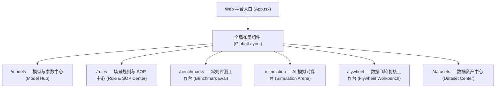

# 前端架构与交互方案设计说明书 (FRONTEND_DESIGN.md)

> **文档版本**: v1.1 (已完成前后端全链路交叉审计与契约严密闭环)  
> **生效时间**: 2026-11-05  
> **设计目标**: 为通用大模型测试管理与数据飞轮平台构建一套现代化、高性能、前后端分离且 100% 契约闭环的 Web 工作台。

---

## 一、 整体设计目标与用户体验原则

本平台前端面向大模型算法工程师、提示词/评测工程师及业务专家，核心解决以下痛点：
1. **多模型横向对比直观化**：在一套界面中同时对比多个模型（或同一模型在开/关思考、不同温度参数下）的工程性能（Latency/TTFT/TPS/思考Token占比）、客观规则与主观打分，支持单样本并排（Side-by-Side）对比。
2. **业务流程图状态机透明化**：通过 Mermaid.js 将抽象的 SOP 流程图以有向图形式直观渲染，对弈时随着会话推进动态高亮流转节点与连线，通话结束瞬间按提取出的节点轨迹执行平滑动画回放，拓扑断路或跳步时实时红框告警。
3. **数据治理人工复核高效化**：采用“可视化轮次比对编辑”与“Monaco 源码 Diff”双视图模式，既保证 50~80 轮长对话中单轮话术微调的高效与 SFT 格式安全，又打通“对弈数据生成 → 质检 → 修复 → 人工复核 → 导出训练集”全闭环。

---

## 二、 前端技术栈选型

| 模块分类 | 技术选型 | 版本/方案 | 选型考量 |
| :--- | :--- | :--- | :--- |
| **基础工程框架** | **Vite + React + TypeScript** | React 18, Vite 5, TS 5 | 极速热重载，与后端 Pydantic 数据契约 100% 类型映射 |
| **基础组件库** | **Ant Design (antd)** | 5.x | 企业级中后台标准库，复杂表格、抽屉、模态框、分割面板开箱即用 |
| **样式与布局系统** | **Tailwind CSS** | 3.x | 高度灵活的原子化 CSS，便于自定义深色卡片、气泡流及自适应布局 |
| **状态机拓扑渲染** | **Mermaid.js (`mermaid`)** | 10.x | 无缝解析后端规则库中的 Mermaid 字符串，支持动态 SVG DOM 操作与节点轨迹高亮 |
| **Diff 与代码编辑**| **`@monaco-editor/react`** | 4.x (VS Code 内核) | 提供工业级左右分栏 Diff 模式，展示多轮对话变更并支持带格式校验的在线修改 |
| **图表可视化** | **ECharts (`echarts-for-react`)** | 5.x | 绘制多模型性能雷达图、各场景分类通过率分布图、TPS 耗时散点图 |
| **通信与数据流** | **Axios + 原生 SSE (`EventSource`) + Zustand** | 现代 Web API | Axios 负责 REST API 调用，Zustand 统一管理活动任务、模型池与场景规则缓存 |

---

## 三、 页面拓扑与信息架构 (Information Architecture)

全局布局采用 **经典侧边导航栏 (Collapsible Sidebar) + 顶部面包屑/任务状态栏 + 主内容自适应视窗**：

---

## 四、 六大核心模块 UI/UX 深度设计

### 4.1 模型与参数中心 (`/models`)

- **功能职责**：管理所有接入平台的模型实例，支持添加标准 OpenAI 兼容模型、Harmony 双通道模型、Vertex AI 及离线自测 Mock 模型。
- **界面线框与布局**：
  - **顶部操作栏**：【注册新模型】按钮、Provider 类型筛选标签（全部 / OpenAI / Harmony / Vertex / Mock）。
  - **模型卡片矩阵**：每张卡片展示：
    - 模型名称、Provider 徽标、API Endpoint 地址（脱敏）、创建时间；
    - **默认思考配置标签**：如 `思考: 开启 (HIGH)` 或 `思考: 关闭`；
    - 快捷按钮：【连通性测试】、【克隆配置】、【编辑】、【删除】。
    > [!TIP]
    > **克隆配置能力**：针对同一底座模型对比开/关思考的需求，用户可一键克隆出独立实例（例如克隆 `qwen-standard` 为 `qwen-thinking-high`），分别持久化其推理参数。
  - **连通性测试抽屉 (Drawer)**：
    - 点击“连通性测试”弹出抽屉，向后端 `POST /api/v1/models/{model_id}/test` 发送试探请求；
    - 实时显示服务端响应状态（成功/失败）、端到端耗时（Latency ms）、剥离后的纯净正文回复与提取的思考链（Thinking 区域支持独立折叠查看）。

---

### 4.2 场景规则与 SOP 中心 (`/rules`)

- **功能职责**：通用业务规则与 Mermaid 状态机的配置视窗。完全与业务硬编码解耦，驱动拓扑连通校验与质检打分。
- **界面线框与布局**：
  - **左侧**：场景规则模板列表（如 `demo_after_sales_template`），支持搜索、复制模板与新建。
  - **右侧**：当前规则详情多标签页（Tabs）：
    - **Tab 1: 业务基础配置**：
      - 编辑机器人 System Prompt；
      - 开场角色选择（`user` / `assistant`）；
      - 最大对弈轮数（`max_turns`）；
      - 礼貌挂机触发关键词列表（如“祝您生活愉快，再见”）。
    - **Tab 2: Mermaid 状态机可视化画布与拓扑动力学**：
      - 左侧为 Mermaid 代码编辑器，右侧为 **SVG 实时动态渲染区**；
      - 标示法定入口节点（`entry_nodes`）与法定出口节点（`terminal_nodes`）；
      - **拓扑高级动力学配置区**：
        - `enabled`：状态机总开关（开启则执行严格图校验，关闭则适配开放式对话/客服闲聊）；
        - `allow_self_loop`：允许节点内自旋（客户插播提问/FAQ解答后拉回主线）；
        - `allow_slot_shortcut`：允许同阶段槽位顺承跳跃；
        - `stage_groups`：同阶段下游节点顺承分组（支持动态增删阶段组）。
    - **Tab 3: 节点检查点与全局红线**：
      - **节点检查点表格**：编辑各节点的 `required_elements`（必含话术要素）与 `fatal_if_skipped_after`（跳步一票否决前置依赖）；
      - **全局红线列表**：违者直接一票否决的高危禁忌条目录入；
      - **质检及格线与准则**：配置 `pass_score_threshold`（默认 85 分）与 `custom_rubric`（附加主观评分说明）。
    - **Tab 4: 数据修复与清洗规范 (Remediation Config)**：
      - `target_turn_range`：重塑目标轮次范围（如 [20, 80]）；
      - `inject_empty_thinking`：是否为 assistant 轮次附加 `"thinking": ""` 字段以对齐基座微调格式；
      - `require_assistant_ending`：强制以 assistant 收口；
      - `strict_alternating_roles`：严格角色交替校验。
    - **Tab 5: 虚拟客户剧本库 (Persona List)**：
      - 卡片列表展示客户角色画像（如“常规配合售后用户”、“一句话多槽位”、“非下单人接听”、“情绪焦虑投诉用户”等），展示角色背景与扮演指令。

---

### 4.3 常规数据集评测工作台 (`/benchmarks`)

- **功能职责**：执行 `1 个评测集 × N 组模型/参数配置` 横向并发对比，全方位评估思考开关对耗时、吞吐与回复质量的影响。
- **界面线框与布局**：
  - **顶部历史评测切换栏**：
    - 下拉选择历史评测任务（对接 `GET /api/v1/benchmarks/tasks`），支持随时切换回溯历史评测报表；
    - 快速展示任务状态（`COMPLETED` / `RUNNING` / `FAILED`）、样本总量与创建时间。
  - **评测任务编排器**：
    1. 选择数据集（从 `/datasets` 中选择或指定 `.jsonl` 路径）；
    2. 多选对比模型：
       - 既支持直接勾选 `/models` 中配置好的多个模型实例；
       - 也支持在勾选某个模型后点击【临时参数覆盖】，修改该实例的 `thinking_enabled` 开关或温度，由前端通过 `model_configs` 数组透传，彻底杜绝主键覆盖冲突；
    3. 选择裁判模型（用于 Rubric 质检打分）；
    4. 点击【开始并发评测】。
  - **宏观性能与质量对比看板 (Overview Dashboard)**：
    - **核心 KPI 统计卡片**：总题数、各模型客观通过率对比、平均延时对比；
    - **多维雷达图 (Radar Chart)**：对比各模型在 Latency、TTFT、TPS、思考 Token 占比、裁判平均分 5 大维度的表现；
    - **分类场景柱状图**：按题型分类（政策咨询、槽位提取、红线防御）展示各模型的准确率差异。
  - **样本级并排对比视窗 (Side-by-Side Comparator)**：
    - 左侧选择具体评测题目，展示系统 Prompt、用户输入与参考答案（Reference）；
    - 右侧按模型分栏（如 Column 1 为模型 A，Column 2 为模型 B），每栏并排展示：
      - 纯净回复正文；
      - 折叠式思考链（`<think>` / `reasoning_content`，展开可查看思考推演过程）；
      - 工程耗时指标胶囊（耗时 120ms / TTFT 45ms / 38 TPS / 思考Token 42%）；
      - 客观规则校验结果（必含词命中情况、违禁词命中情况、JSON 格式是否合法）；
      - 裁判评分徽标（如 `85分 PASS`）与扣分理由点评。

---

### 4.4 AI 模拟对弈台 (`/simulation`)

- **功能职责**：为对话机器人提供可视化的“实战练兵场”。驱动虚拟客户与被测机器人进行多轮实操博弈与事后拓扑轨迹复盘。
- **界面线框与时序设计**：
  - **对弈配置栏**：选择规则模板 -> 选择被测机器人模型 -> 选择客户模拟器模型 -> 选择质检法官模型 -> 选择对弈用例 -> 点击【启动对弈】（对接 `POST /api/v1/flywheel/simulate`）。
  - **双栏交互工作台**：
    - **左栏：对弈聊天气泡流 (Live Chat Arena)**：
      - 仿通话界面的聊天视窗；
      - 蓝色气泡为虚拟客户（展示口语化自然回复），绿色气泡为被测机器人；
      - 气泡下方带有单轮耗时（如 `⏱️ 1.2s`）与思考链折叠入口；
      - 客户输出 `[挂断电话]` 或客服输出结束语时，界面自动渲染【通话正常结束】收口卡片。
    - **右栏上方：Mermaid 状态机轨迹动画回放 (Topology Replay Tracker)**：
      - 嵌入式展示当前规则的 Mermaid SOP 流程图；
      - **时序与动画机制**：通话进行期间保持安静对弈；通话结束瞬间由后端白盒质检提取完整 `node_trajectory`，前端按轨迹顺序执行 **“状态机流转动画步进回放 (Node 1 ➔ Node 2 ➔ Node 3)”**，所经节点平滑过渡为高亮绿色边框；
      - 若质检检出悬空跃迁或跳步，对应转移线变为红色虚线并附带感叹号。
    - **右栏下方：白盒质检诊断面板 (Realtime Judge Panel)**：
      - 呈现白盒质检得分（0~100 分）与 `PASS / FAIL` 状态；
      - 节点检查点核验清单（如 N1_1 身份核验: 达标、N2_1 设备状态核查: 达标）；
      - 检出缺陷定位列表；
      - **一键入库与流转**：模拟对弈产物已由后端自动持久化至 SQLite，附带【前往飞轮工作台复核】快捷跳转按钮。

---

### 4.5 数据飞轮与质检复核工作台 (`/flywheel`)

- **功能职责**：数据飞轮闭环的核心枢纽。汇聚初检、AI 修复与二次验收后的样本，供人工复核与导出纯金微调集。
- **界面线框与布局**：
  - **顶部过滤栏**：按规则筛选、按状态筛选（`全部` / `GOLD_PASS` 及格直通 / `REPAIRED_PASS` 修复合格 / `DISCARDED` 淘汰隔离 / `MANUAL_APPROVED` 人工放行）。
  - **样本列表与质检看板**：
    - 表格列出样本 ID、用例场景、初检得分、最终得分、状态标签、更新时间；
    - 点击任意一行，在下方或弹出抽屉中进入**深度 Diff 复核区**。
  - **双视图智能多轮 Diff 对比区 (Dual-View Diff Editor)**：
    > [!IMPORTANT]
    > **双视图设计原则**：默认采用“轮次级并排比对视窗”，防止质检员直接编辑原始 JSON 破坏角色交替或收尾格式；同时保留高级 Monaco JSON Diff 模式。
    1. **视图一：轮次级气泡流比对编辑模式（Turn-by-Turn Diff，默认）**：
       - 左栏展示**原缺陷对话轮次**，顶部悬浮质检法官的诊断报告（失分环节定位、违规红线项与扣分原因）；
       - 右栏展示**AI 重塑修复后的黄金对话轮次**，高亮修复补全的合规话术；
       - **安全微调编辑**：质检员点击右侧任意一轮气泡即可行内修改话术，由系统自动更新并保持合规的 `messages` 结构；
    2. **视图二：Monaco 源码 Diff 模式（高级）**：
       - 采用 VS Code 内核 Monaco Diff 对比两份完整 JSON；
       - 点击【保存修改】时强制执行前端 `validate_and_sanitize_format` 校验，确保角色交替合法。
  - **人工裁决操作条 (Review Action Bar)**：
    - 【人工放行并通过 (MANUAL_APPROVED)】：人工捞回并赋予入库资格（对接 `PUT /api/v1/flywheel/samples/{id}`）；
    - 【标记淘汰 (DISCARDED)】：永久隔离；
    - 【触发定点纠偏补考】：针对当前样本调用 Teacher 模型重新修复与二次质检（对接 `POST /api/v1/flywheel/samples/{id}/remediate`）。
  - **版本化微调训练集导出模态框 (Export Modal)**：
    - 点击【导出微调数据集】（对接 `POST /api/v1/flywheel/export`）；
    - 选项包括：是否包含人工审核放行样本、是否为 `assistant` 自动注入空思考字段（`"thinking": ""`）、版本标签（如 `v1.1`）。

---

### 4.6 数据资产中心 (`/datasets`)

- **功能职责**：管理平台所有评测集与飞轮产出的版本化训练集，提供预览、格式抽检与快速任务流转。
- **界面线框与布局**：
  - **数据集卡片/表格**：
    - 展示数据集 ID、文件名、样本总量、类型标签（`benchmark` 常规评测集 / `flywheel_gold` 飞轮黄金集）；
    - 操作栏：【样本抽检预览】、【作为评测集发起评测】、【下载 JSONL】。
  - **样本抽样抽屉 (Sample Preview Drawer)**：
    - 对接 `GET /api/v1/datasets/{id}/samples?limit=20`；
    - 展示每条样本的输入问答气泡、标准参考答案（Reference）、客观校验规则（Rubric: 必含词、违禁词、正则模式、JSON合法性）；
    - 支持一键将该数据集填充至 `/benchmarks` 页面启动对比测试。

---

## 五、 前端与后端 REST API 完整映射契约

| 前端工作台页面 | 触发的用户动作 | 后端对接 API 路由 | 请求方法 | 核心入参 / 返回模型 |
| :--- | :--- | :--- | :---: | :--- |
| **ModelHub** | 获取模型列表 | `/api/v1/models/` | GET | 返回 `List[RegisteredModel]` |
| **ModelHub** | 注册新模型 | `/api/v1/models/` | POST | `ModelCreateRequest` (含 ModelConfig) |
| **ModelHub** | 更新模型配置 | `/api/v1/models/{model_id}` | PUT | `ModelUpdateRequest` (可改名称、URL、Key、配置) |
| **ModelHub** | 删除模型 | `/api/v1/models/{model_id}` | DELETE | 返回删除成功消息 |
| **ModelHub** | 在线连通性测试 | `/api/v1/models/{model_id}/test` | POST | 返回 reply, latency_ms, thinking |
| **RuleCenter** | 获取规则模板列表 | `/api/v1/rules/` | GET | 返回 `List[RuleSummary]` |
| **RuleCenter** | 获取规则完整配置 | `/api/v1/rules/{rule_id}` | GET | 返回完整 `UniversalRuleSchema` JSON |
| **RuleCenter** | 保存/更新规则配置 | `/api/v1/rules/` | POST | 提交 `UniversalRuleSchema`，同步持久化 |
| **DatasetCenter** | 获取数据集列表 | `/api/v1/datasets/` | GET | 返回 `List[DatasetRecord]` |
| **DatasetCenter** | 预览数据集样本 | `/api/v1/datasets/{id}/samples` | GET | `limit=10~5000`，返回样本明细 |
| **DatasetCenter** | 外部评测集/数据集导入 | `/api/v1/datasets/import` | POST | 支持本地文件上传、在线粘贴 JSONL 或本地路径导入并校验 Schema |
| **DatasetCenter** | 删除数据集资产 | `/api/v1/datasets/{id}` | DELETE | 删除数据库记录与本地 `.jsonl` 文件 |
| **BenchmarkEval** | 查询历史评测列表 | `/api/v1/benchmarks/tasks` | GET | `limit=20`，返回历史评测概要与通过率 |
| **BenchmarkEval** | 触发多模型矩阵评测 | `/api/v1/benchmarks/run` | POST | `BenchmarkRunRequest` (支持 model_configs 覆盖) |
| **BenchmarkEval** | 查询评测进度与结果 | `/api/v1/benchmarks/tasks/{id}` | GET | 返回 status, progress, summaries 概要 |
| **BenchmarkEval** | 获取并排对比明细 | `/api/v1/benchmarks/tasks/{id}/side_by_side` | GET | 返回单样本 Side-by-Side 多栏对比字典 |
| **SimulationArena** | 启动模拟对弈任务 | `/api/v1/flywheel/simulate` | POST | `SimulationRunRequest`，返回对弈对话、质检报告并自动入库 |
| **FlywheelWorkbench**| 批量飞轮治理任务 | `/api/v1/flywheel/batch` | POST | `BatchFlywheelRunRequest` (初检->修复->二次验收->隔离) |
| **FlywheelWorkbench**| 查询复核样本列表 | `/api/v1/flywheel/samples` | GET | `task_id`, `status`, `limit` 过滤 |
| **FlywheelWorkbench**| 人工改判或微调话术 | `/api/v1/flywheel/samples/{id}` | PUT | `SampleReviewUpdateRequest` |
| **FlywheelWorkbench**| 触发单样本定点补考 | `/api/v1/flywheel/samples/{id}/remediate` | POST | 调用 Teacher 修复并重新质检打分 |
| **FlywheelWorkbench**| 导出黄金微调数据集 | `/api/v1/flywheel/export` | POST | 导出带版本号的 `messages` 格式 JSONL |

---

## 六、 实施分步计划

1. **Step 1: 脚手架初始化与基础依赖配置**
   - 使用 Vite 初始化 React + TypeScript 工程于 `frontend/`；
   - 安装并配置 Ant Design 5、Tailwind CSS、Lucide 图标库、Mermaid.js、Monaco Editor 与 ECharts；
   - 配置 Vite Proxy 反向代理，将 `/api` 请求代理至本地 FastAPI 后端 `http://127.0.0.1:9021`。
2. **Step 2: API 接口层与类型契约落地**
   - 编写 `frontend/src/types/`，根据 `backend/app/schemas/` 严格定义数据类型；
   - 编写 `frontend/src/api/`，封装对接上述 20 个 RESTful 接口的 Axios 客户端。
3. **Step 3: 通用核心交互组件研发**
   - 研发 `MermaidViewer`（支持状态机流程图渲染与节点轨迹动画高亮）；
   - 研发 `TurnDiffViewer`（支持多轮对话气泡安全比对与行内微调编辑）；
   - 研发 `MetricRadarChart`（支持多模型耗时、TTFT、TPS、思考Token占比雷达图）。
4. **Step 4: 页面逐一实现与后端全链路联调**
   - 依次实现 ModelHub、RuleCenter、DatasetCenter、BenchmarkEval、SimulationArena、FlywheelWorkbench 6 大页面并与后端端到端跑通。
